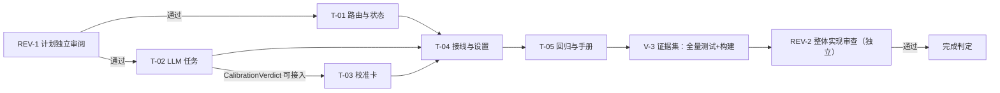

# Runwu 英文输入校准实现计划

| 计划标识 | 内容 |
| --- | --- |
| 版本与状态 | v1.1，2026-11-02；REV-1 已通过（无阻塞，plan-reviews/001.md），按其非阻塞意见完成表达层修订；批准执行 |
| 设计基线 | `docs/designs/english-input-calibration.md` v1.6（复审通过版）；独立复审记录 `docs/designs/design-reviews/001–005.md`，005 结论"可实施、无阻塞" |
| 代码基线 | Runwu `4815b09`（分支 `codex/caret-translation`，工作区含未跟踪的设计与审阅文档，随首个提交入库） |
| 执行授权 | 用户 2026-11-02：按 delivery 流程执行；计划门由独立 agent 审核不经用户；连续执行至整体实现与测试完成；完成后按 [[install-after-verification]] 构建安装，人机复验留给用户 |
| 计划身份 | `delivery-plan` skill，契约版本 1（plan-standard v1.0） |

## 1. 计划定位与设计承接

**实现目标**：润物在源语言=中文时对纯英文句自动弹出"英文校准卡"（判定徽标 + 原句回译 + 问题列表 + 复制修正句），默认关闭、由「英文校准」开关控制；`swift test` 全量通过且既有翻译行为断言不变；产出可安装的本地构建。

**范围**：设计 v1.6 全部条款（D-C1～D-C14；拉丁文字范围已接受）。**排除**：真机手测（A2/A3/A7/A8 真机部分、A12/A13）、一周试用（A10）——属用户复验与发行阶段（依据：设计第 10 章 A10 为发行前判据 + 用户 2026-11-02 授权连续执行）；发行说明与版本号变更不在本计划。

**全局约束**：

| ID | 约束 | 来源 |
| --- | --- | --- |
| G-1 | 不 push；本地 commit，格式 `T<N>: <任务名>`，只 stage 本任务文件 | 仓库约定 |
| G-2 | 既有测试**行为断言语义不变**，允许因签名/Entry 结构做机械适配；A1 以此为口径 | 设计第 8 章 |
| G-3 | 设计批准版本只读；实现偏离设计机制/契约时先改设计再实施 | delivery 约定 |
| G-4 | 校准提示词与 `calibrationPromptVersion` 为常量集中定义于 LLMTranslation.swift | D-C13 |
| G-5 | 已知偶发失败 `TranslationHistoryTests.testDailyBackupCreatesSnapshotWithRows` 单跑确认即视为非阻塞 | 仓库环境注意点 |
| G-6 | 不改翻译引擎、历史、朗读、替换原文、剪贴板路径行为 | 设计影响表 |

**设计阻塞**：无（设计的"质量延迟/JSON 遵从/IME 组合上报"三项为待实测，不阻塞实施）。

## 2. 交付分解与覆盖关系

| 任务 ID | 交付成果 | 设计引用 | 前置依赖 | 验收归属 |
| --- | --- | --- | --- | --- |
| T-01 | 路由与状态基础：`RouteDecision` 纯函数（含 isTruncated）、`ExtractedSentence.isTruncated`、`CalibrationState`、`InputCoordinator` 开关注入/route 回调/同语言不 reset、诊断保留 | 4.1、5.2、D-C9/D-C10 | REV-1 通过 | A4、A11（单测部分）→ V-1 |
| T-02 | LLM 校准任务：提示词常量+版本、`CalibrationVerdict`、`LLMModelRouter.calibrate`（非 thinking、4096、failover、malformed）、`CalibrationCoordinator`（LRU 缓存、reconfigure/cancel） | 4.2、5.1、D-C4/D-C5/D-C13 | REV-1 通过（与 T-01 并行） | A6 → V-1 |
| T-03 | 浮窗校准卡：`Entry.content` 枚举、共享卡片外壳、`CalibrationCardView`、`showCalibration`、`CalibrationCardSizing`（fittingSizeNatural 临时宿主、forceScroll 公式） | 4.3、D-C12/D-C14 | T-02（CalibrationVerdict 类型可接入） | A8（渲染部分）→ V-1 |
| T-04 | AppState 接线与设置：路由分发与清理（dismiss/invalidate 拆分、alsoClearCalibration）、`calibrationGeneration`、设置链分流、`acceptCalibrationResult` 五重校验、校准失败通道、设置项+L10n+诊断 | 4.1/4.4/5.2、N-11～N-23 全部修复 | T-01/T-02/T-03 可接入 | A1/A3/A5/A7/A9/A14/A15/A16 → V-2、V-3 |
| T-05 | 整体回归与手册：全量 `swift test`、README 增补「英文输入校准」说明段 | 设计第 9/10 章 | T-01～T-04 完成 | A1（全量）→ V-3 |

**覆盖矩阵**（设计验收 → 任务 → 验证）：

| 设计验收项 | 归属 | 验证 |
| --- | --- | --- |
| A1 零行为变化（含源语言非中文） | T-04/T-05 | V-3 全量测试 + G-2 口径 |
| A2/A3 真机体验 | T-04 逻辑 + 用户复验 | V-2 集成测试覆盖逻辑；真机留复验 |
| A4 路由矩阵（含截断） | T-01 | V-1 `CalibrationRouteTests` |
| A5 取消/旧卡/防抖窗口 | T-01/T-04 | V-2 `CalibrationIntegrationTests` |
| A6 解码与校验 | T-02 | V-1 `CalibrationDecodingTests`（合同测试） |
| A7 失败通道 | T-04 | V-2 单测 |
| A8 卡片机制（渲染/量高） | T-03 | V-1 `CalibrationCardSizingTests` + Overlay 适配 |
| A9 隐私 | T-04 | V-2 隐私断言 |
| A10/A12/A13 真机试用 | 不阻塞 | 用户复验与发行阶段 |
| A11 长句跳过 | T-01 | V-1 单测 |
| A14 启动已开启 | T-04 | V-2 `CalibrationStartupTests` |
| A15/A16 隔离 | T-04 | V-2 `CalibrationIntegrationTests` |

**合同包**：中低风险（本地功能、默认关、无数据迁移）。合同真源 = 设计 5.1 解码与校验规则八条；合同测试 = `CalibrationDecodingTests`，随 T-02 实现（规则逐条对应设计正文，非实现者自定预期）；红测预期：解码器未实现前该测试文件不存在（新增型合同，无独立红测阶段）。

## 3. 依赖、阶段与启动条件

| 边 | 条件含义 |
| --- | --- |
| REV-1 → T-* | 计划审阅通过（用户授权 agent 审，阻塞全部实施） |
| T-02 → T-03 | `CalibrationVerdict` 类型与 `calibrate` 契约已落定 |
| T-01/02/03 → T-04 | 三者产物可接入（类型与接口编译可用即可，不必等各自测试全绿） |
| T-04 → T-05 | 接线完成，全链路可编译 |
| T-05 → V-3 | 全量测试与构建证据形成 |
| V-3 → REV-2 | 证据集完整，供整体审查 |
| REV-2 → 完成判定 | 整体审查无阻塞发现 |

资源：单写者（同一会话顺序实施），无并行写冲突。环境依赖验收：无（真机项全部后置）。

## 4. 任务说明

### T-01 路由与状态基础

| 字段 | 内容 |
| --- | --- |
| 范围与约束 | 仅路由/取句/状态机层；不改 AppState 与浮窗；G-2/G-6 |
| 前置与启动条件 | REV-1 通过 |
| 必读材料 | 设计 4.1、5.2；Models.swift:88-228/316-362；Input.swift:50-212 |
| 目标与产物 | `RouteDecision`、`Route` 枚举、`CalibrationState`（新文件 Sources/Pico/Calibration.swift 或并入 Models.swift，实现者定）；`ExtractedSentence.isTruncated`；`SentenceExtractor` 截断置位；`InputCoordinator` 三项改动 |
| 设计依据 | 4.1 规则表/机制 1–3、5.2 前两行 |
| 代码位置 | Models.swift:90-119（isTruncated）、Input.swift:57/73-76/115-212、新增文件 |
| 实施步骤 | ① `ExtractedSentence` 加 `isTruncated`（显式 init 默认 false，既有构造零改动）；截断分支置 true。② `RouteDecision.decide(text:isTruncated:sourceLanguage:calibrationEnabled:)`：按 4.1 规则表实现，源=中文才可能 `.calibrate`。③ `CalibrationState` 镜像 RealtimeTranslationState（Models.swift:190-227）的 revision/mutationID/beginRequest/accepts，update 只收 `.calibrate` 句。④ InputCoordinator：加 `calibrationEnabled`；`emit` 用 RouteDecision 替换 detector guard（Input.swift:196），`.none` 保留既有诊断；`onSentence` 加 route 参数；`handle`/`observe` 每快照算 route，变化即回调 `onRouteChanged`（不经防抖）；`setSourceLanguage` 同语言直接返回不 reset。⑤ 测试：`CalibrationRouteTests`（4.1 表逐行+截断）、`CalibrationStateTests`（令牌/失效）、SentenceExtractor isTruncated 用例、InputCoordinatorTimingTests 机械适配+route 用例（涉及签名的 InputPipelineDiagnosticTests/CaretTrackingTests/FocusedEditableInputTests 一并机械适配，见设计第 8 章清单） |
| 验收与验证归属 | A4 全矩阵、A11 单测；既有 InputCoordinatorTimingTests 断言语义不变 |
| 细化状态 | 已细化 |
| 反馈触发 | 发现 4.1 规则表与代码现状冲突（如 emit 结构无法挂 route）→ 停止并回报 |

### T-02 LLM 校准任务

| 字段 | 内容 |
| --- | --- |
| 范围与约束 | 仅 LLM 层；翻译 encode 默认行为不变（calibrate 走独立分支）；G-4 |
| 前置与启动条件 | REV-1 通过（与 T-01 无依赖） |
| 必读材料 | 设计 4.2、5.1 八条规则；LLMTranslation.swift:313-721；Models.swift:387-489 |
| 目标与产物 | `calibrationSystemPrompt`/`calibrationPromptVersion` 常量、`CalibrationVerdict` 值类型（Sendable）、`LLMModelRouter.calibrate(_:)`、`CalibrationCoordinator` actor |
| 设计依据 | 4.2、5.1、D-C4/D-C5/D-C13 |
| 代码位置 | LLMTranslation.swift（prompt :6-10 旁、Router :313-480、encode/decode :599-721）、新增 CalibrationCoordinator（并入新文件） |
| 实施步骤 | ① 常量：提示词按 4.2 五要点中文书写；version 如 `"cal-v1"`。② `CalibrationVerdict`：verdict/backTranslation/corrected/issues(quote/kind/reason/fix)，kind 五枚举。③ `calibrate`：复用 request/timeout/failover 循环；messages 用校准提示词+原句；OpenAI 兼容不发 reasoning_effort、Claude 不发 thinking 且 max_tokens=4096（新增 encode 分支或参数）；解码走 5.1 八条规则（剥离围栏、取首{末}、先过滤有效条目再判 verdict、good 带有效条目降 minor 等）；任一步失败记 `malformedCalibration`。④ `CalibrationCoordinator`：镜像 TranslationCoordinator 代次/取消（Models.swift:387-489），LRU ≤64（key=version+\0+text），`reconfigure` 清缓存。⑤ 测试：`CalibrationDecodingTests` 按设计 5.1 八条逐条+宽容/ malformed 边界（合同测试）；LLMModelRouterTests 加 calibrate fixture（成功/failover/全 malformed） |
| 验收与验证归属 | A6；缓存与取消单测 |
| 细化状态 | 已细化 |
| 反馈触发 | encode 结构无法区分 thinking 参数（需重构 encode 签名）→ 回报 |

### T-03 浮窗校准卡

| 字段 | 内容 |
| --- | --- |
| 范围与约束 | 仅浮窗层；翻译卡宿主类型与渲染断言不变（G-2）；外壳可降级为共享子组件等价实现 |
| 前置与启动条件 | T-02 的 CalibrationVerdict 可接入 |
| 必读材料 | 设计 4.3 全节；Overlay.swift:12-128/193-267/821-900/1002-1200/1256-1330/1352-1511 |
| 目标与产物 | `Entry.content` 枚举、共享卡片外壳（自 TranslationOverlayView 抽取可复用部分，**翻译卡宿主类型与行为不变**）、`CalibrationCardView`、`OverlayCoordinator.showCalibration`、`CalibrationCardSizing` |
| 设计依据 | 4.3 全节（两模式对照/线框/量高公式/交互/失败通道视图侧）、D-C12/D-C14 |
| 代码位置 | Overlay.swift（Entry :822-871、makeView :1150-1196、installContent :1076-1102、show 家族 :1002-1072/1434、OverlaySizing :193-267、拖选 :1256-1330） |
| 实施步骤 | ① `Entry` 增加 `content` 枚举（.translation(text,sourceText)/.calibration(verdict,source)），text/sourceText 保留为计算属性以最小化既有代码改动。② 抽外壳：标题栏/按钮槽位/WindowDragCatcher 挂载/SelectableBodyTopKey 回传/hover/resize 由共享组件承载；TranslationOverlayView 改为使用外壳，渲染断言不变。③ CalibrationCardView 按线框：徽标（good 绿✓/minor 黄⚠/major 红✗）、原句、回译、问题列表（quote/kind 标签/reason/fix）、修正句（good 且==原句时隐藏）、复制按钮（复制 corrected）。④ 量高：measuredNatural 分段 textHeight 求和+chrome；fittingSizeNatural 用未设 textHeightLimit 的临时 NSHostingView（同宽真实文案）；按设计公式 forceScroll（textHeightLimit=max(limit-chrome,60)，面板=max(limit, chrome+textHeightLimit)）。⑤ `showCalibration` 复用 realtime origin 路径；无 translationContext；自动隐藏 max(hideAfter,10s)，`neverHide` 开启时永不隐藏（D-C14）。⑥ 测试：`CalibrationCardSizingTests`（非滚动≥内容/超限 forceScroll/测量低估/极端 chrome）；OverlayCoordinatorRendering/Selection/Pinning/Sizing 机械适配+校准卡用例 |
| 验收与验证归属 | A8 渲染与量高断言 |
| 细化状态 | 已细化 |
| 反馈触发 | 外壳抽取会改变翻译卡渲染结构（既有测试无法保持语义）→ 回报，允许改为"共享子组件而非整体外壳"的等价方案（属实现细节） |

### T-04 AppState 接线与设置

| 字段 | 内容 |
| --- | --- |
| 范围与约束 | 接线与设置层；翻译既有行为零改变（G-6）；诊断与提示不落原文 |
| 前置与启动条件 | T-01/T-02/T-03 产物编译可接入 |
| 必读材料 | 设计 4.1 机制 4–7/状态表/推演、4.4、5.2；App.swift:90-240/346-377/615-745/928-1045；Settings.swift:264-646；SettingsUI.swift 翻译页 |
| 目标与产物 | 路由分发、清理拆分、calibrationGeneration、设置链分流、accept 校验、失败通道、SettingsStore/UI/L10n、诊断 |
| 设计依据 | 4.1 机制 4–7/状态表/推演、4.4、5.2、N-11～N-23 |
| 代码位置 | App.swift（init :90-240、applyTranslationSettings :346-377、handleInputSnapshot :615-637、translate :639-690、accept :691-745、presentFailure :928-1045）、Settings.swift、SettingsUI.swift、L10n.swift |
| 实施步骤 | ① `handleInputSnapshot` 按 route 喂两状态机；`handleRouteChanged` 按设计机制 4 清理。② `dismissCalibrationCard`/`invalidateCalibrationState` 拆分实现；`clearRealtimePresentation(alsoClearCalibration: Bool = false)`。③ `calibrationGeneration` + `applyCalibrationSettings` + applyTranslationSettings delta 分流（该函数内同样同步 `input.calibrationEnabled`，设计 4.1 机制 2 三处同步之一）（affectsCalibration = source/models/timeout 任一变化；仅 sourceChanged 调 setSourceLanguage）。④ `acceptCalibrationResult` 五重校验（enabled/generation/accepts/route==.calibrate/session）；不写历史不朗读。⑤ `CalibrationFailureState` + 独立提示窗（标题"英文校准失败"），清除时机按设计。⑥ Settings：`calibrationEnabled`（默认 false）+ `onCalibrationSettingsChanged`；「翻译」页设置组（不受 backend 条件限制；开关开时显示模型管理入口；文案含拉丁范围与"至少显示 10 秒"）；L10n 中英。⑦ 诊断：route/requested(含 promptVersion)/failed/malformed/skipped(reason)，报告加 calibrationEnabled 与 promptVersion。⑧ init 同步 input.calibrationEnabled。⑨ 测试：CalibrationIntegrationTests（A3/A5/A15/A16 场景、.none、防抖窗口、连续 A→B→C）、CalibrationStartupTests（A14）、CalibrationSettingsTests、SettingsStoreTests 适配、TranslationDiagnosticPrivacyTests 扩展（A9） |
| 验收与验证归属 | A1/A3/A5/A7/A9/A14/A15/A16 |
| 细化状态 | 已细化 |
| 反馈触发 | 翻译路径必须改行为才能接入（违反 G-6）→ 停止回报 |

### T-05 整体回归与手册

| 字段 | 内容 |
| --- | --- |
| 范围与约束 | 不改代码行为；README 只增不删 |
| 前置与启动条件 | T-04 完成、全链路可编译 |
| 必读材料 | 设计第 9/10 章；README.md 现状 |
| 设计依据 | 设计第 9 章（兼容与发布）、第 10 章 A1 |
| 代码位置 | README.md（使用手册区段） |
| 反馈触发条件 | 全量测试出现非 G-5 覆盖的既有用例失败 → 停止回报 |
| 目标与产物 | 全量 `swift test` 通过记录、README「英文输入校准」段落（开关位置、行为、隐私去向、拉丁范围、长句/片段限制） |
| 实施步骤 | ① 全量测试（G-5 口径处理偶发失败）。② README 增补（不改既有段落语义）。③ 提交。 |
| 验收与验证归属 | A1 全量；README 段落与设计一致 |
| 细化状态 | 已细化 |

## 5. 验证组织与完成判定

**审查安排**：

| 审查组 | 覆盖 | 审查者 | 启动条件 | 阻断 |
| --- | --- | --- | --- | --- |
| REV-1 计划审阅 | 本计划对设计的承接、任务可交接性、依赖/门禁无环、验证充分性 | 独立 agent（未参与设计与计划编写；与设计审阅者可为同一 agent——其已具备上下文且独立于计划作者） | 计划 v1.0 落盘 | 阻塞全部实施 |
| REV-2 整体实现审查 | T-01～T-05 全部产物与跨任务集成；规格符合性与实现质量分别结论；显式核对既有测试的机械适配符合 G-2（断言语义未变） | 独立 agent（不得为实现者；可与 REV-1 同一 agent） | T-05 全量测试通过 | 阻塞 V-3 收尾 |

批次阈值：本次为单一连续交付，无中间批次审查；REV-2 兼任整体审查（review yield 在 REV-2 报告记录）。

**验证组**：

| ID | 目标 | 覆盖 | 方法 | 通过标准 | 门禁 | 证据 |
| --- | --- | --- | --- | --- | --- | --- |
| V-1 | 单元与合同 | T-01/T-02/T-03 及 AC-A4/A6/A8/A11 | `swift test --filter`（各任务提交前） | 相关 filter 全绿 | 任务提交条件 | 测试输出摘要入实施记录 |
| V-2 | 集成 | T-04 及 A1/A3/A5/A7/A9/A14/A15/A16 | `swift test --filter Calibration`（其全量结果可被 V-3 复用，不重复三跑） | 全绿 | T-05 启动条件 | 同上 |
| V-3 | 整体证据集 | 全部 | `swift test` 全量 + `zsh Scripts/build-app.sh`；随后 REV-2 | 0 失败（G-5 除外）+ 构建成功 | 供 REV-2 与完成判定；通过后构建安装 | 输出与签名验证入实施记录 |

**完成判定**（plan-standard 偏差说明：整体审查置于独立验收证据之后、完成判定之前，两道门齐备且强度不低于规范要求）：T-01～T-05 已实现 + V-1/V-2 通过 + V-3 证据集完整 + REV-2 无阻塞发现 ⇒ 本计划范围完成；随后按 [[install-after-verification]] 构建安装到 /Applications，交用户人机复验（真机项 A2/A3/A8 手测、A12/A13、A10 试用属复验与发行阶段，不阻塞本计划完成）。

## 6. 执行记录与恢复约定

| 记录 | 位置 |
| --- | --- |
| 任务进度/偏差/证据 | `.delivery/2026-11-02-english-input-calibration/status.md`（唯一权威，随任务更新） |
| 实施记录 | 同目录 `implementation.md`（合并式，含身份/版本/检查/遗留） |
| 审查记录 | REV-1 → 同目录 `plan-reviews/001.md`；REV-2 → `implementation-reviews/001.md` |
| 验证证据 | status.md 内嵌摘要（命令+结果行），完整输出不留档 |

恢复规则：恢复会话先读 status.md 与 git log 核对版本，再续下一任务；有效证据不重复执行。

## 7. 计划检查、细化与变更

- 机械检查：`python3 <delivery-plan>/scripts/check_plan.py <本文件>`。
- 语义自检：作者自检（承接/可交接/无环/验证充分）后交 REV-1；REV-1 发现回本计划修订（阻塞项与受影响章节）。
- 变更边界：代码位置/局部步骤调整记入实施记录偏离段；任务拆分、依赖、验收变化产生新计划版本并重新 REV-1；设计机制变化回设计文档（G-3）。
- 本计划批准（REV-1 通过）后只读；执行状态只在 status.md。

---

**未写内容**：无。真机与发行阶段工作不在本计划范围，已在覆盖矩阵标注归属。
