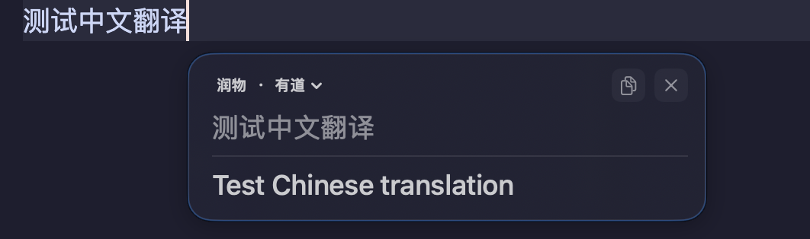
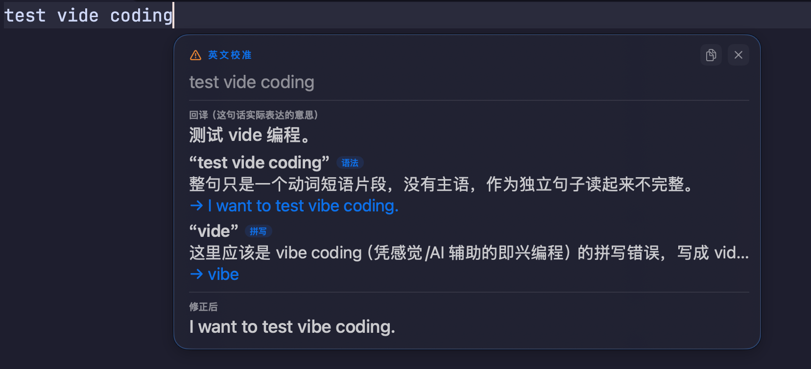
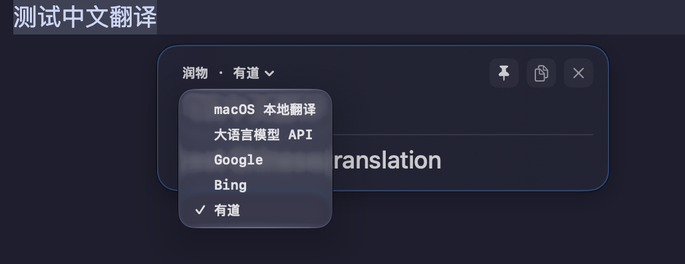

# 润物（Runwu）

润物是一款 macOS 菜单栏翻译工具，基于 [Pico](https://github.com/asiyoua/pico) 扩展。它读取当前输入框已上屏的当前句子并显示原文与译文，浮窗默认跟随文字插入光标；中文输入法尚未提交的组合文字不会发起翻译。

使用手册：[下载安装](#下载安装) · [功能](#功能) · [翻译服务](#翻译服务) · [本地构建](#本地构建) · [排错](#排错)

## 下载安装

**v0.4.0 支持 Apple Silicon（arm64）、macOS 15 或更高版本**。从 [v0.4.0 发行页](https://github.com/cmeng-CM/Runwu/releases/tag/v0.4.0) 下载 `Runwu-0.4.0.dmg`，把「润物.app」拖到 Applications 链接，推出镜像后启动。改动与更新注意事项见 [v0.4.0 发行说明](docs/releases/v0.4.0.md)。

安装包只有本地 ad-hoc 签名、没有 Developer ID 签名或公证：首次打开若被拦，核对下载来源后在「系统设置 → 隐私与安全性」按提示选择「仍要打开」。首次使用需在「隐私与安全性 → 辅助功能」授权润物；默认苹果本地翻译需先准备所选语言方向的语言包。

润物不自动更新：到 [GitHub Releases](https://github.com/cmeng-CM/Runwu/releases) 下载新 DMG、退出润物、替换后重启即可。应用内继承的更新检查与自动下载链路已整体禁用，运行时不向 GitHub 发起任何更新请求。

## 功能



- **输入翻译**：默认中文 → 英文，停顿约 450ms 后翻译当前句；可切换完整句子或快捷键触发（快捷键可在设置录制）。输入框、应用或句子改变后旧请求作废，不会覆盖新句。
- **浮窗**：跟随光标并自动避让输入框；可钉住、固定位置、拖动。原文区拖动窗口，译文区拖选文字自动复制选中段，头部复制键复制整段译文；也可显式触发「替换原文」（范围校验不通过则拒绝，不会覆盖正在输入的中文）。
- **英文校准**（默认关，需配置语言模型）：纯英文句发送到所配端点，卡片显示判定徽标、中文回译、逐条问题与修正句，可一键复制修正句；至少显示 10 秒，判定失败显示独立失败提示，不冒充校准结果。不写历史、不朗读、不自动替换输入；暂停翻译会同时暂停校准。详见[英文输入校准设计](docs/designs/english-input-calibration.md)。
- **剪贴板翻译**（默认关）：快捷键或自动监听模式；被排除应用拒绝的复制不会事后补读。剪贴板卡的复制/替换/朗读可分别配置。
- **窗口**：常驻菜单栏；打开设置时显示 Dock，全部设置窗口关闭后隐藏。
- **隐私**：可配置排除应用；密码框与安全输入状态阻止读取；输入历史只存本机，可查看、导出、清除并配置保留期限；诊断只含受控错误类别与数字状态，不含原文或密钥。
- **宿主兼容**：Chromium 系文档编辑器（实测 Obsidian）的两套坐标偏移已做锚窗映射处理（见[行尾映射设计](docs/designs/obsidian-line-end-mapping.md)与[输入链路诊断](docs/designs/obsidian-input-diagnostics.md)）；辅助功能与光标定位依赖宿主实现，个别宿主可能取句或定位受限，可改固定位置或剪贴板翻译。



各机制的实现与维护决策见 [docs/designs/](docs/designs/)；历史核验记录见 [docs/verification-log.md](docs/verification-log.md)。

## 翻译服务



一次使用一个所选服务；语言、服务或模型配置改变后，在途请求与缓存一并失效。翻译卡头部可切换服务并按原句重译，不重新读取输入。

| 服务 | 配置与数据去向 |
| --- | --- |
| 苹果本地（默认） | 语言包准备后在设备上翻译；准备包可能需要网络 |
| Google / Bing | 无需用户 API key；待译文本发送到对应网页翻译端点 |
| 有道 | 无需用户 API key；先取一次匿名会话 cookie（该请求不含待译文本），再发送待译文本 |
| 自定义语言模型 | 仅此模式显示模型编辑器：端点、模型、提示词、密钥、超时、启停与拖动排序，按启用顺序失败回退 |

自定义模型的密钥保存在本机偏好文件（仅本用户可读）；不随模型快照发往任何地方，但会随本机备份（如 Time Machine）携带明文，备份介质请注意保管。网页服务需要网络，可能限流、受地区网络影响或改变协议，不保证长期可用。

## 本地构建

需要 macOS 15+、完整 Xcode 与 Swift 6 工具链；仓库不引入第三方 Swift 包。

```sh
swift test
zsh Scripts/build-app.sh   # 构建 润物.app 并签名
zsh Scripts/build-dmg.sh   # 打包 dist/ 润物-<版本>.dmg（发行固定 ad-hoc 签名）
```

本机开发建议先运行一次 `zsh Scripts/setup-signing.sh`：生成自签证书「Runwu Local」（10 年）并开启信任后，辅助功能授权跨构建与升级保留；ad-hoc 签名每次重建都会被当成新 App，授权与登录项整体重置。`build-app.sh` 只读取身份、从不创建证书或改钥匙串；证书缺失（新机器、CI）时自动退回 ad-hoc。需要显式指定身份时用 `CODESIGN_IDENTITY='已有签名身份' zsh Scripts/build-app.sh`。签名身份一旦更换，所有用户的辅助功能授权与登录项都会重置；p12 私钥备份的位置与保管说明见 `setup-signing.sh` 注释。

## 排错

| 现象 | 检查 |
| --- | --- |
| 输入后没有浮窗 | 菜单栏未暂停？辅助功能已授权？当前应用不在排除列表？源语言匹配？密码框和某些宿主不支持读取 |
| 浮窗不跟随或暂时消失 | 宿主可能不提供文字或输入框几何；关闭跟随、用固定位置或剪贴板翻译，检查自动隐藏设置 |
| 浮窗压住输入框 | 宿主报告几何不准；在「通用」设置生成诊断，`probe` 行显示宿主是否报告输入框矩形与光标位置 |
| 苹果本地服务不可用 | 在翻译设置准备当前语言方向的语言包，等待完成 |
| 网页服务失败 | 查看菜单栏失败提示，检查网络，稍后重试或切换服务 |
| 自定义模型失败 | 核对端点、模型名、密钥、启用状态、超时与协议兼容性 |

必要时在「通用」设置生成诊断（权限、读取状态、错误类别，不含原文或密钥）。不要在公开反馈中粘贴密钥或私人文本。

## 来源与许可证

底座为 Pico 源码 commit `990c604240be1207b9e581658d7a7b3a2c4b699e`（MIT），保留原 [LICENSE](LICENSE) 与版权信息；光标定位与服务协议参考 Pretype、Easydict 的思路，用系统框架独立实现，没有复制 GPL 源码。应用图标为用户批准的生成原图，菜单栏为独立单色适配；旧 SVG 素材来自 Tabler Icons（MIT），完整来源与生成命令见[图标署名](Resources/Icons/ATTRIBUTION.md)。应用包随附 LICENSE 与图标署名。
