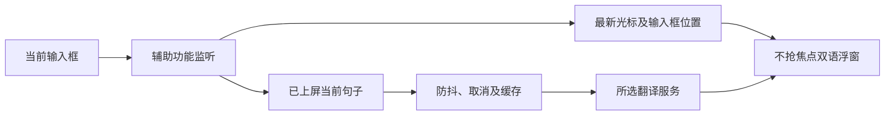

# Runwu 光标跟随翻译设计

| 元信息 | 内容 |
| --- | --- |
| 状态 | 已接受，实施中 |
| 设计分级 | 标准，输入/浮窗/翻译服务增量改造 |
| 最后更新 | 2026-10-08 |
| 来源与讨论入口 | 本次 Codex 对话；Pico 本地源码与 README；工作流 caret-translation |

> 背景、取舍是判断依据；接口与数据形状是执行契约；限制和交付留给维护者。Always：保留确认范围。Ask first：扩大范围或发布。Never：上传输入历史或自动写回中文。

## 一句话方案

基于 Pico，在 Runwu 实现上屏中文当前句子自动中英翻译、插入光标跟随、输入框附近降级，以及苹果/Google/Bing/有道/自定义模型选择。

## 背景与目标

用户实测 Pico 基本能读取常用应用，但译文固定。已逐项确认上屏后翻译、当前句子、文字插入光标、允许输入框降级、采用 Pico。用户明确要求先实现，具体应用兼容问题在使用中反馈，不增加应用名单前置审批。
承接 /Users/cm/workspace/github/pico 当前源码，原仓库只读；当前 Runwu 为空仓库。保留 MIT 来源，参考 Pretype 光标定位及 Easydict 服务协议，独立实现，不复制 GPL 源码。

## 做法

位置事件独立于文本去重和翻译：移动光标、换行、滚动及窗口移动更新最新锚点。原生字符范围定位优先，text-marker 补充，坐标校验失败退到输入框边缘。所有锚点使用全局 Cocoa 点坐标，按所在显示器布局。
当前句子采用约 450ms 输入防抖；有效组合区尚未提交时不产生新翻译。请求代次、输入会话及句子版本共同防止迟到结果；返回译文时使用最新位置。实时模式维护一张活动卡，钉住的历史卡保留原行为；剪贴板卡仍按固定位置显示，不依赖输入框锚点。
一次使用一个所选服务，苹果本地为默认。模型沿用端点/模型/提示词/钥匙串；网页服务具备独立 URLSession 适配、动态握手、超时及错误反馈。服务/模型/提示词改变使缓存和在途请求失效。

## 备选与取舍

| 方案 | 取舍 |
| --- | --- |
| FloatTrans | 用户已选择浮窗能力更丰富的 Pico |
| Easydict | 服务丰富，但需新增跨应用输入和跟随链路 |
| 键盘事件重建中文 | 读取已上屏文本，避免依赖输入法候选 |
| 字体估算光标 | 富文本/折行/缩放可能错位，优先真实坐标，失败降级 |
| 同时查询全部服务 | 增加请求、成本与干扰，使用可选择单服务 |

## 明确不做

不开发输入法；不要求全部应用精确定位；不安装或改变系统权限；不推送/部署/发布；不自动上传历史；不复制 GPL 源码。仅在当前仓库实现已讨论功能，Pico 原能力沿用。

## 实际交付

无（尚未实现，整体终审时回写真实产物）。

## 已知限制

辅助功能及定位依赖宿主应用。text-marker 不是稳定公开跨应用契约，需回退。苹果翻译需语言包。网页服务可能限流、变更或受地区网络影响，失败须显式呈现。2026-10-08 调研固定短句探测：Google 与有道成功，Bing 返回 401 或空响应。协议接入不等于上游实时可用。自动化固定坐标/HTTP 夹具不证明全部应用兼容；真实应用问题由用户使用反馈推进。

## 验收标准

| 不变量 | 验证 |
| --- | --- |
| 中文组合提交与当前句子索引正确 | 组合输入、句子/emoji/重复句测试 |
| 文字不变仍随几何变化移动 | 独立事件和浮窗测试 |
| 多屏不越界、失败降级、恢复跟随 | 坐标与布局测试 |
| 不抢焦点，钉住卡不跟随，旧会话结果丢弃 | NSPanel 和时序测试 |
| 三家网页服务真实协议、显式失败 | URLProtocol 夹具及固定短句网络探测 |
| 配置持久化、旧值兼容、缓存隔离 | 设置与服务路由测试 |
| 本地可构建、签名和许可证完整 | swift test、build-app.sh、codesign 检查 |

## 决策摘要

| ID | 结论 | 来源 | 连带项 |
| --- | --- | --- | --- |
| D-01 | Pico 底座，当前 Runwu 实现 | 用户 | 保留来源和既有功能 |
| D-02 | 上屏中文，不绑定输入法 | 用户 | 组合检测与提交后翻译 |
| D-03 | 光标所在当前句子 | 用户 | 索引和重复句测试 |
| D-04 | 插入光标跟随 | 用户 | 独立几何事件和多屏 |
| D-05 | 失败退到输入框附近 | 用户 | 降级和恢复 |
| D-06 | 苹果/Google/Bing/有道/模型 | 用户 | 适配、设置和路由 |
| D-07 | 沿用覆盖，使用中处理兼容问题 | 用户 | 不阻塞于应用名单 |
| D-08 | 中英对应，位置不等待翻译 | 用户 | 请求/会话身份校验 |
| D-09 | 系统框架、独立协议实现 | agent | 不引入第三方依赖或复制 GPL |
| D-10 | 独立 Runwu 应用身份、本地签名 | agent | 避免原 Pico 安装/更新冲突 |

## 接口与数据形状

| 接口 | 契约 |
| --- | --- |
| TextSnapshot | 新增 caretFrame: NSRect?、isComposing: Bool 默认值，保留 UTF-16 selectedRange |
| InputAnchor | caretFrame: NSRect?、fieldFrame: NSRect?，全局 Cocoa 坐标 |
| onAnchorChanged | ((InputAnchor, InputSessionID) -> Void)?，几何事件在文本去重前发出 |
| 锚点更新 | 与译文 show 分离，仅移动当前活动卡，不重置隐藏计时 |
| TranslationEngine | translate(_ text: String, from: Language, to: Language) async throws -> String |
| TranslationBackend | 保留 local/languageModel，增加 google/bing/youdao |
| 请求身份 | 会话、句子版本、配置代次匹配方可接受 |
| 错误 | 区分网络/HTTP/协议/空结果，取消不显示为失败 |

## 兼容迁移与回滚

内部保留 Pico Swift target；输出 Runwu.app，Bundle ID com.cmeng.runwu、独立钥匙串服务，不迁移原 Pico 配置。禁止从 Pico 上游自动替换本地构建。跟随为默认新增模式，保留固定模式。回退当前仓库提交即可，不影响原 Pico 安装。
