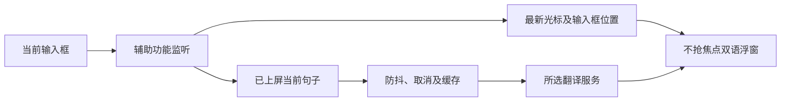

# Runwu 光标跟随翻译设计

| 元信息 | 内容 |
| --- | --- |
| 状态 | 已实现；本地测试/构建/签名通过，真实宿主人工验收待进行 |
| 设计分级 | 标准，输入/浮窗/翻译服务增量改造 |
| 最后更新 | 2026-10-13 |
| 读者与维护 | 维护者；已接受方案保留，接口、限制、交付与实现决策随代码维护 |
| 来源与讨论入口 | 本次 Codex 对话；Pico 本地源码与 README；工作流 caret-translation |

> 背景、取舍是判断依据；接口与数据形状是执行契约；限制和交付留给维护者。Always：保留确认范围。Ask first：扩大范围或发布。Never：上传输入历史或自动写回中文。

## 一句话方案

基于 Pico，在 Runwu 实现上屏中文当前句子自动中英翻译、插入光标跟随、输入框附近降级，以及苹果/Google/Bing/有道/自定义模型选择。

## 背景与目标

用户实测 Pico 基本能读取常用应用，但译文固定。已逐项确认上屏后翻译、当前句子、文字插入光标、允许输入框降级、采用 Pico。用户明确要求先实现，具体应用兼容问题在使用中反馈，不增加应用名单前置审批。
承接 /Users/cm/workspace/github/pico 当前源码，原仓库只读；当前 Runwu 为空仓库。保留 MIT 来源，参考 Pretype 光标定位及 Easydict 服务协议，独立实现，不复制 GPL 源码。

## 做法

位置事件独立于文本去重和翻译：移动光标、换行、滚动及窗口移动更新最新锚点。原生字符范围定位优先，text-marker 补充，坐标校验失败退到输入框边缘。所有锚点使用全局 Cocoa 点坐标，按所在显示器布局。
跟随摆放优先保证输入框不被压住：把「输入框矩形 ∪ 光标框」当作整块障碍，依次取第一个整张放得下的位置——障碍下方/上方（先试离光标更近的一侧，中线附近留死区不翻面）、光标行左/右侧（高度不超过屏幕 0.6 倍的输入框大到上下都没位置时）、最后在贴光标与贴屏幕上下缘之间取压住输入框面积更小的一侧。障碍构成先过 0.6 屏高门槛（D-30，与祖先兜底同一判定）：高度超过所在屏 0.6 倍的输入框矩形不当障碍（恰为 0.6 倍及以下仍按既有规则避让），这一情形只避光标框、卡片贴光标行落下，可能压住编辑器其它行（整屏编辑器宿主把整个编辑器报成一个输入框，Chromium contenteditable 实测 Obsidian 报 89% 屏高）。并集是必要的：宿主可能把光标框报在输入行之外（ZCode 实测报高一整行），只避光标框的旧规则会把卡片正好落在输入行上。输入框矩形也有两种宿主差异：Chromium 系把光标框报在文档坐标系里（Chrome 实测光标 y 远超屏幕高度），而焦点文本节点常常自己不带矩形——这时向上取最近一个「像输入框」的祖先矩形（有效、与本屏相交、横向盖住光标、高度不超过屏幕 0.6 倍，与跟随障碍同一判定），跳过整窗/整页容器；取不到就只用光标框。关闭跟随的固定模式实时卡与同屏自动卡作为一组按配置槽位落位，被输入框压住时整组按同一增量挪开（保持堆叠间距，无锚点的剪贴板卡随组一起走），输入框移开后整组自动回到配置位置；屏幕确实没有干净位置时整组留在槽位。
当前句子采用约 450ms 输入防抖；有效组合区尚未提交时不产生新翻译。请求代次、输入会话及句子版本共同防止迟到结果；返回译文时使用最新位置。实时模式维护一张活动卡，钉住的历史卡保留原行为；剪贴板卡没有自己的输入框锚点，仍按固定布局显示（固定模式下随同屏整组让位）。
一次使用一个所选服务，苹果本地为默认。模型沿用端点/模型/提示词/钥匙串；网页服务具备独立 URLSession 适配、动态握手、超时及错误反馈。服务/模型/提示词改变使缓存和在途请求失效。

## 备选与取舍

| 方案 | 取舍 |
| --- | --- |
| FloatTrans | 用户已选择浮窗能力更丰富的 Pico |
| Easydict | 服务丰富，但需新增跨应用输入和跟随链路 |
| 键盘事件重建中文 | 读取已上屏文本，避免依赖输入法候选 |
| 字体估算光标 | 富文本/折行/缩放可能错位，优先真实坐标，失败降级 |
| 同时查询全部服务 | 增加请求、成本与干扰，使用可选择单服务 |

## 明确不做

不开发输入法；不要求全部应用精确定位；不安装或改变系统权限；不推送/部署/发布；不自动上传历史；不复制 GPL 源码。仅在当前仓库实现已讨论功能，Pico 原能力沿用。

## 实际交付

| 产物 | 实际交付与原因 |
| --- | --- |
| 独立应用与构建 | `Sources/Pico`、`Resources/Info.plist`、`Scripts/build-app.sh`；润物 / com.comeg.runwu / 润物.app，独立运行时路径与钥匙串，默认 ad-hoc 签名，停用 Pico 上游替换 |
| 安全输入与锚点 | `CaretTracking.swift`、`Input.swift`；读取原文前检查排除、安全输入和 AX 安全元数据，独立几何事件、组合状态和同应用换框会话，主屏原点转换 |
| 当前句与浮窗 | `Input.swift`、`Models.swift`、`App.swift`、`Overlay.swift`；真实 UTF-16 范围、请求/会话/版本校验，原文改变立即清旧配对，活动卡跟随，历史钉住卡冻结，剪贴板独立固定布局 |
| 浮窗避让输入框 | `Overlay.swift`、`Input.swift`；跟随卡按「输入框 ∪ 光标框」整块避让（下方/上方 → 光标行左右 → 贴光标或屏幕边少压），固定模式按整组挪位并随输入框移开回位；`updateAnchor` 同步 `avoid`，诊断探针补报锚点几何整数坐标供宿主差异定位 |
| 三家网页协议 | `WebTranslation.swift`、`YoudaoTranslation.swift`；可注入 URLSession、全句编码、动态握手与匿名会话、超时、取消与受控错误，不新增外部依赖 |
| 路由与配置隔离 | `Models.swift`、`LLMTranslation.swift`、`App.swift`；五服务选择、不可变请求配置、双 coordinator 原子失效及 ready 屏障，苹果 host generation 防快速方向往返合并 |
| 设置和使用说明 | `SettingsUI.swift`、`L10n.swift`、`README.md`；模型编辑仅模型服务显示，网页数据去向/有道源自动识别说明，默认跟随开关、固定卡控制的准确作用，中英文文案 |
| 回归与本地产物 | `Tests/PicoTests` 覆盖安全读取、位置/内容状态、真实 SwiftUI host、路由及 HTTP 夹具；发布脚本产物包含许可证与图标署名 |
| 整屏编辑器宿主避让 | `CaretTracking.swift`、`Overlay.swift`、`Tests/PicoTests/OverlayFieldAvoidanceTests.swift`；`InputScreenLayout` 新增 `fieldHeightLimitFraction = 0.6` 与 `withinFieldHeight` 判定（祖先兜底与跟随障碍共用同一阈值），`OverlayFollowingLayout.obstacle` 丢弃高度超过所在屏 0.6 倍的输入框矩形，跟随卡退化为贴光标行；回归用例 `OverlayFieldAvoidanceTests.testFollowingCardHugsTheCaretWhenTheFieldFillsTheScreen`（Obsidian 归一化几何、宽窄两种卡，先红后绿） |

T1—T6 已逐任务独立审查通过；整体终审 I-01/I-02 在 T7 统一修复组合读取错误与自动剪贴板读前排除边界。T7 最终全量共 242 项，其中 1 项联网探测默认跳过，0 失败；新增组合故障/恢复及剪贴板读前准入回归。T6 原失败因果组合（浮窗+网页协议）68 项、1 跳过、0 失败。release 构建与 `codesign --verify --deep --strict 润物.app` 通过；产物为本地 ad-hoc 签名，身份 com.comeg.runwu，LICENSE 与图标署名逐字匹配源文件。真实应用人工验收仍待使用反馈；未启动或安装应用。生产苹果原生 session/语言包和用户模型端点未实测，不用注入引擎测试替代这些结论。

## 已知限制

辅助功能及定位依赖宿主应用，text-marker 不是稳定公开跨应用契约，需要回退。AX 采用单消息 50ms 超时及整次读取 120ms 停止启动后续调用的预算；这不是整个采样硬耗时保证。自动化坐标和 HTTP 夹具不证明全部应用兼容，真实应用问题由用户使用反馈推进。

浮窗避让依赖宿主报告几何：宿主完全不报告输入框、祖先链里也没有可用容器时，障碍只剩光标框——Chromium 系把光标框报在文档坐标系里（Chrome 实测 y=4211，远超屏幕），卡片按它落下仍可能压住输入行；输入框矩形整体报偏且输入框贴屏幕上缘时，避让按报出的矩形计算，与真实输入行仍可能重叠。整屏编辑器宿主（Chromium contenteditable，实测 Obsidian 把整个编辑器报成一个输入框）按 D-30 把高度超过所在屏 0.6 倍的矩形排除出障碍：跟随卡贴光标行落下，只保证不压光标行，可能压住编辑器其它行；光标框几何也不可信、只剩整屏矩形时没有可用锚点，仍走旧兜底——贴光标或屏幕缘并接受压住正文，不改善。屏幕找不到任何干净位置时（整组放不下：卡堆高或输入框大），跟随卡贴光标或上下缘并接受少压输入框，固定卡整组留在配置槽位并压在输入框上——固定卡同进同退是为了不出现卡片互相压住，代价是没有干净位置时不会把其中一张单独换角；此时不再保证输入行完整可见。跟随卡选边是纯函数、无跨帧记忆：光标在输入框中线两侧的不同行之间移动（半行以上）仍会整块翻面。卡片高度是 TextKit 估高与实测渲染取大值，字体/行高差异下可能比内容高几点空白（此前短到会裁剪并画出面板之外）。

苹果翻译需要语言包。已验证真实 SwiftUI host 的配置身份重建及旧代次拒绝意图，但没有下载包或实测原生 session attach。用户模型端点也未调用。网页服务可能限流、变更或受地区网络影响，失败显式呈现；一次短句成功不保证长期可用。

2026-10-12 14:35:14 复测：实际生产适配器以 `.chinese → .english` 翻译固定「你好，世界。」，Google `Hello World.`、Bing、有道 `Hello, world.`，三者成功；2026-10-08 18:01:19 首次探测结果相同。早期研究 Bing 401/空响应已由实际接入修正后探测更新，不再代表当前验证结果。2026-10-12 同时更新有道结论：翻译端点要求携带网页匿名会话 cookie（`OUTFOX_SEARCH_USER_ID`，一次 fanyi.youdao.com 页面请求即可取得），缺少或失效时返回 code50；请求体缺少 `keyid=webfanyi` 时端点返回与原句无关的诱饵译文。适配器先取会话再签名握手，被拒时重取会话并重试一次；`from=zh-CHS` 与 `from=auto` 当前均返回 code0，仍固定 `from=auto` 源自动识别、目标显式指定，应用源语言仅用于本地输入筛选。默认全量跳过联网探测，显式 `RUNWU_WEB_LIVE_PROBE=1` 才发送固定非敏感短句。

## 验收标准

| 不变量 | 验证 |
| --- | --- |
| 中文组合提交与当前句子索引正确 | 组合输入、句子/emoji/重复句测试 |
| 文字不变仍随几何变化移动 | 独立事件和浮窗测试 |
| 跟随/固定卡不压高度不超过 0.6 屏高的输入框，输入框移开后固定卡整组回位 | 避让布局单测与协调器回归（含宿主把光标框报在输入框外、翻面死区、整组挪位与回位、空隙不相交不挪位、无干净位置回退、高度超过所在屏 0.6 倍的输入框矩形不当障碍改贴光标行） |
| 多屏不越界、失败降级、恢复跟随 | 坐标与布局测试 |
| 不抢焦点，钉住卡不跟随，旧会话结果丢弃 | NSPanel 和时序测试 |
| 三家网页服务真实协议、显式失败 | URLProtocol 夹具及固定短句网络探测 |
| 配置持久化、旧值兼容、缓存隔离 | 设置与服务路由测试 |
| 本地可构建、签名和许可证完整 | swift test、build-app.sh、codesign 检查 |

## 决策摘要

| ID | 结论 | 来源 | 连带项 |
| --- | --- | --- | --- |
| D-01 | Pico 底座，当前 Runwu 实现 | 用户 | 保留来源和既有功能 |
| D-02 | 上屏中文，不绑定输入法 | 用户 | 组合检测与提交后翻译 |
| D-03 | 光标所在当前句子 | 用户 | 索引和重复句测试 |
| D-04 | 插入光标跟随 | 用户 | 独立几何事件和多屏 |
| D-05 | 失败退到输入框附近 | 用户 | 降级和恢复 |
| D-06 | 苹果/Google/Bing/有道/模型 | 用户 | 适配、设置和路由 |
| D-07 | 沿用覆盖，使用中处理兼容问题 | 用户 | 不阻塞于应用名单 |
| D-08 | 中英对应，位置不等待翻译 | 用户 | 请求/会话身份校验 |
| D-09 | 系统框架、独立协议实现 | agent | 不引入第三方依赖或复制 GPL |
| D-10 | 润物安装名称、com.comeg.runwu 独立身份、本地签名 | 用户 | 用户 2026-10-08 明确指定名称与 Bundle ID；避免原 Pico 安装/更新冲突 |
| D-11 | 有道网页源语言自动识别、目标显式指定 | agent | 固定短句实测：`from` 显式与 `auto` 当前均可用，端到端另需页面会话 cookie 与 `keyid=webfanyi`；不以官网语言表误推断请求能力 |
| D-30 | 高度超过所在屏 0.6 倍的输入框矩形不作为跟随避让障碍、卡片贴光标行 | 用户 2026-10-13 | 收窄 D-26 的「障碍上方/下方无位置时再光标行左右」到高度不超过所在屏 0.6 倍的矩形；恰为 0.6 倍及以下仍按既有规则避让；超过 0.6 倍时卡片贴光标行、可能压住编辑器其它行；光标框不可信而只剩整屏矩形时仍按旧兜底贴屏幕缘——无可用锚点，不改善；门槛只作用于输入框矩形、光标框不受限（它已在 `InputScreenLayout.caretRect` 受 4…200 点约束，由 `AXFieldReader.caretFrame` 调用）；门槛按放置屏（`frame` 候选序先光标框、后输入框所选中的那块屏）计高；侧贴与无干净位置回退用例改用不超过 0.6 屏高的几何，保持原覆盖 |

实现判断保留在仓库中，报告只承载检查日志与提交证据：

| ID | 实现选择与依据 | 连带项及代价 |
| --- | --- | --- |
| D-12 | 诊断只记录已知错误类别、错误类型和数值状态，禁止任意 description/reflection；界面另用受控短提示 | 防上游回显原文/密钥进入诊断，减少未经约束的错误细节 |
| D-13 | 排除/安全检查先于原文；可选 AX attributeUnsupported/noValue 兼容缺失，cannotComplete/failure/预算耗尽失败关闭 | 不把暂时 API 错误当正常缺失；安全容器不递归找子文本，鼠标回退限制当前 PID |
| D-14 | AX 全局坐标从 NSScreen.screens 首项主屏顶翻转；单消息 50ms、序列 120ms 启动预算 | 活跃 `.main` 与所有屏 maxY 都不能充当主屏原点；预算不承诺硬实时 |
| D-15 | 当前句携带真实 UTF-16 范围，同应用换框生成新会话；观测句变化/组合恢复同步去重状态 | 重复句、emoji、完整句 timing 返回旧句仍能恢复；显式替换先验证该范围内原文 |
| D-16 | realtime / clipboard origin 分离；只有存活且未钉住活动实时卡读取最新同会话锚点 | 几何不续计时或重译，失位暂隐藏可恢复，超时/关闭不复活；钉住与手动位置冻结 |
| D-17 | Bing rich_tta IID、IG、独立 SFX、同 session cookie/final host、动态 TTL 与 cachebuster，205 至多刷新一次 | 接受已知 transliteration metadata，401/403/429/空响应显式失败，不循环或绕过登录 |
| D-18 | Youdao 动态公开签名握手、页面匿名会话 cookie 与 code50 单次重取会话、MD5 raw16 AES-CBC 与严格 PKCS7；所有表单/query 用 RFC3986 unreserved 编码 | 全句与多段返回，保留字面 +；翻译体缺 `keyid=webfanyi` 会返回与原句无关的诱饵译文；D-11 源自动识别限制由请求对照决定，不按语言表猜测 |
| D-19 | 服务同步构造不可变 engine；App 串行 ready revision 屏障，两个 coordinator 原子取消/清缓存 | 新请求不能读旧配置；整个模型回退冻结 URL/prompt/key/thinking/order/timeout，密钥不序列化 |
| D-20 | 苹果同语言对保留 session；真实方向改变递增 holder hostConfiguration.generation，生产 SwiftUI `.id(generation)` 重建 | A→B→A 不依赖被 render 合并的 pair onChange；attach 严格匹配 pair+generation；取消 waiter/超时各绑定 UUID |
| D-21 | 错误使用独立只读 notice，取消/过期静默；失败清对应 pending 操作且不成为翻译数据 | 不写历史、朗读、复制或替换，live/clipboard 错误彼此隔离 |
| D-22 | follow 设置默认 true，单独持久化呈现回调；固定位置/边距仍可配置剪贴板和预览 | 模式切换不重配服务、不重译；固定控制不影响跟随中的实时卡，模型 UI 仅 languageModel |
| D-23 | 活动卡和透明测量非激活 panel 明确 animationBehavior=.none | macOS27 全量及浮窗+网页组合采样复现 64 个 NSAnimation 阻塞 worker，饿死夹具回调；移除系统出现/消失视觉过渡，保留布局/固定/跟随/钉住/计时及原测试，不改未证明参与的其他窗口 |
| D-24 | marked AX 查询保留未知状态；attributeUnsupported/noValue 保持正常缺失兼容，其余 API 错误或预算耗尽不能当未组合 | 未知采样不读 AXValue、不使用快捷键缓存，同步刷新输入会话并取消旧防抖/请求身份、清去重；独立几何仍发布，后续可信同 text/range 可恢复，不伪造一次提交 |
| D-25 | 自动剪贴板 watcher 和 App 自动入口共享读前 enabled/模式/排除准入，读取器与前台身份可注入 | 拒绝仍推进 changeCount，离开排除应用不补读旧内容；禁止先获取字符串再过滤。显式快捷键保留用户授权语义，不新增剪贴板安全框识别范围 |
| D-26 | 浮窗摆放把「输入框 ∪ 光标框」当整块障碍避让：先障碍下方/上方（近光标侧优先，中线留死区），再光标行左右，最后贴光标或屏幕边取压住面积更小者；固定模式实时卡与同屏自动卡整组就地挪位、输入框移开自动回位 | 用户 2026-10-10 反馈跟随卡压住输入行、看不到输入内容与光标；实测 ZCode 把光标框报在输入行之外，只避光标框必然落回输入行 | 位置随输入框变化而移动（跟随更「跳」，跨中线换行仍翻面）；整组放不下时跟随卡仍接受少压、固定卡留在槽位 |
| D-27 | 诊断探针补报锚点几何（整数坐标 + 是否落在输入框内，荒谬数值标 insane），仅在用户主动生成的本地报告里 | 避让依赖输入框矩形，宿主不报告几何时需要能区分「缺失」与「偏移」，否则只能靠截图反推 | 报告多一行坐标；仍不含文本与密钥 |
| D-29 | 面板高度取「SwiftUI 实测渲染」与「TextKit 实测文本高度」的较大值；NSHostingView 只保留 `.intrinsicContentSize`，不把窗口尺寸绑到 SwiftUI 内在尺寸 | 用户 2026-10-10 复现「仍会盖住」：落点已避开输入框（日志 `covers_field=false`）而卡片仍压住——面板按塌缩的 fittingSize 摆成 110 点、内容约 190 点画出面板之外；调大后又被内在尺寸最大值夹回 | 卡片高度可能比内容多几点文本估值余量；面板尺寸不再由 SwiftUI 自动决定 |
| D-28 | 输入框矩形缺失时向上取最近一个「像输入框」的祖先矩形（跳过整屏容器）；避让失败时账本里留下几何日志（`anchor` 与 `follow card` 两行，只记坐标与是否压住） | 用户 2026-10-10 复现「仍会盖住」：Chromium 宿主（ZCode 实测）焦点文本节点不带 AXPosition/AXSize，光标框又在文档坐标系里，卡片只能贴光标落下 | 祖先链是启发式，宿主结构差异大时可能取不到（退回只避光标框）；日志多两行坐标 |

## 接口与数据形状

| 接口 | 契约 |
| --- | --- |
| TextSnapshot | caretFrame: NSRect?、isComposing: Bool 默认值，UTF-16 selectedRange；组合/几何读取在文本+range 去重前 |
| InputAnchor / onAnchorChanged | caretFrame / fieldFrame 全局 Cocoa 坐标，携带 InputSessionID；同步会话/安全失效后才能读新原文；内部 Geometry.isComposing 为 Bool?，nil 表示 marked 查询不可信，独立锚点不被该错误阻断 |
| ExtractedSentence | 当前句原文与真实 UTF-16 range，版本键包含位置；禁止从重复原文反向猜最后一处 |
| RealtimeTranslationState | 请求身份、会话、句子版本及配置代次共同校验；切框/应用/空值/当前句变化同步清旧结果 |
| Overlay origin / anchor | realtime(session) 与 clipboard 分离；接受结果使用最新同 session anchor，更新锚点不重置隐藏计时 |
| settings.overlayFollowCaret | Bool 默认 true，持久化；独立回调设置 Overlay.followCaret，不触发配置 revision；OverlayPosition 仍仅固定布局生效 |
| PendingTranslationAction | 记录真实当前句范围，执行替换前验证范围内原文；保持用户显式触发 |
| TranslationEngine | translate(_ text: String, from: Language, to: Language) async throws -> String；有道内部源自动识别，应用输入筛选与目标语言不变 |
| TranslationBackend | 保留 raw local / language-model 和默认 local，增加 google / bing / youdao |
| TranslationCoordinator | reconfigure(from:to:revision:) 原子取消、清缓存及更新方向/代次；translateThrowing 接受 caller revision，旧值取消 |
| TranslationService / App readiness | 完整不可变 engine 快照；App 串行 configurationTask 完成两 coordinator 和 service 更新后才允许该 revision 请求 |
| TranslationHostConfiguration | source、target、单调 generation；holder 同 pair 不 reset，真实方向改变发布新值；SwiftUI 子树按 generation 重建，旧 task 不可 late attach |
| PasteboardReading / PasteboardWatcher | 可注入 changeCount 与 readString；watcher 先推进基线、再 permitsRead、最后读字符串；App 自动入口读前执行同策略，拒绝同步基线；显式操作维持既有 enabled 开关 |
| 错误 | 受控网络/HTTP/协议/空结果分类；独立只读短提示，取消/过期静默；诊断不记录原文/密钥或任意错误描述 |

## 兼容迁移与回滚

内部保留 Pico Swift target、Runwu 可执行文件；安装及显示名为润物，输出 润物.app，Bundle ID com.comeg.runwu、独立钥匙串服务，不迁移原 Pico 配置。禁止从 Pico 上游自动替换本地构建。跟随为默认新增模式，保留固定模式。回退当前仓库提交即可，不影响原 Pico 安装。
