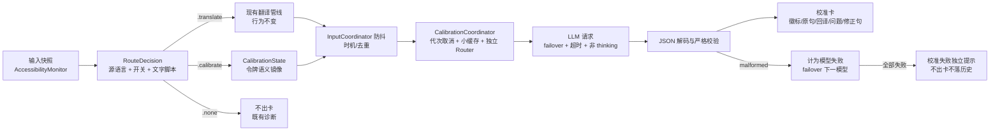

# Runwu 英文输入校准设计

| 元信息 | 内容 |
| --- | --- |
| 状态 | v1.6 复审通过版（可实施）；第五次独立复审结论"可实施、无阻塞"；2 项非阻塞（N-22/N-23）已修；待用户批准进入计划；未实施、未测试、未验收 |
| 设计分级 | 标准，输入路由/LLM 任务/浮窗内容形态/设置增量改造 |
| 适用基线 | Runwu `4815b09`（分支 `codex/caret-translation`，v0.4.0 / build 5，工作区干净） |
| 需求与参考依据 | 2026-11-02 对话：①输入英文需确认语义正确、符合英文表达；②浮窗需同时显示中文以做中英验证；③基于润物现有机制设计。市场调研：Grammarly 无中文、火山写作已关停、"校对+中文回译一体"无现成产品 |
| 审阅依据 | 独立审阅 [001](design-reviews/001.md)（v1.1）、[002](design-reviews/002.md)（v1.2）、[003](design-reviews/003.md)（v1.3）、[004](design-reviews/004.md)（v1.4）、[005](design-reviews/005.md)（v1.5，结论可实施） |
| 交付身份 | `delivery-design` skill，契约版本 `1`，skill 修订 `13aaa45`；v1.6（2026-11-02 第五次复审通过并修非阻塞项；v1.5 第四次复审修复；v1.4 第三次复审修复；v1.3 复审修复；v1.2 审阅修复；v1.1 两模式确认；v1 同日初稿） |
| 实施边界 | 独立复审已通过，具备实施条件；待用户批准后按 delivery 流程进入计划（delivery-plan）与实施。待实测项（R-1/R-2/R-7）不阻塞实施，约束发行（A10/A13） |

## 方案概览

润物按**源语言设置 + 当前句文字**自动路由：源语言为中文时，中文句走现有中译英翻译，纯英文句走新增的英文校准；源语言为英/法/德/西/日/韩/俄时，行为完全沿用现状（校准不触发）。校准一次 LLM 调用返回结构化 JSON（三档判定 + 问题列表 + **原句**中文回译 + 修正句），以校准卡显示在与翻译卡同一套跟随光标浮窗里；同一时刻只有一张活动卡，按路由自动切换形态，旧活动卡在新句到达时立即收起。语言路由永远自动；唯一开关「英文校准」只控制源语言=中文时的英文路由（默认关），菜单栏「暂停」是共同总闸。校准固定走自定义模型列表（与翻译共享配置、failover 与超时），请求与解码失败不冒充结果。v1 不自动回写输入框、不落历史。

## 1. 背景、目标与范围

用户是中文母语者，写英文（消息、邮件、commit、文档）时无法确认"这句英文是否正确表达了本意、是否地道"。已确认的调研事实：Grammarly 实时校对无中文界面与回译；火山写作（中文界面 Grammarly 平替）2024-12-31 关停；翻译工具（含润物现状）只译不判。需求本质是"**校对 + 回译**"合体：对错判断解决"写得对不对"，对**原句**的中文回译解决"说的是不是我想说的"。

### 目标表

| 问题/需求依据 | 改造目标 | 预期结果 | 验收口径 |
| --- | --- | --- | --- |
| 写英文时不知道语义/语法是否正确 | 输入英文句子后浮窗给出判定与问题点 | 三档判定 + 逐条问题（片段、类型、中文原因、改法） | A2、A10 |
| 无法验证英文是否表达本意 | 同一浮窗显示**原句**的中文回译 | 回译与判定同卡呈现；回译不基于修正句 | A2、A10 |
| 不增加操作负担 | 复用现有停顿防抖自动触发，无需划词或快捷键 | 停顿约 450ms 发起请求，典型 2–6s 出卡 | A2 |
| 现有翻译行为不能受影响 | 校准只在源语言=中文时接管原本被丢弃的英文句 | 开关关闭时全量行为零变化；开启时中文句照常翻译；其他源语言配置零变化 | A1、A3、A4 |

### 范围表

| 项 | 是否包含 | 理由 |
| --- | --- | --- |
| 实时输入英文句子的自动校准（判定/问题/回译/修正句） | 包含 | 核心需求 |
| 校准卡跟随光标、钉住、复制修正句、拖选复制 | 包含 | 复用既有浮窗机制 |
| 设置开关（默认关）+ 中英双语文案 + 模型可用性提示 | 包含 | 成本与隐私需用户显式选择 |
| 校准结果落历史记录 | 不包含（v1） | 历史表无 kind 列且无列迁移机制；校准内容是用户自写文本，暂不落库降低隐私面 |
| 一键回写输入框（应用修正） | 不包含（v1） | LLM 修正句与原文范围对齐有错配风险；与"替换必须显式验证"的既有哲学一致，先复制后手贴 |
| 朗读、上下文多句校准、非英文目标语言 | 不包含（v1） | 控制范围；见第 11 章 |
| 剪贴板路径校准、划词校准 | 不包含（v1） | 先验证核心输入场景的使用频率 |

## 2. 现状分析与影响范围

### 相关现状（已核实，文件:行号）

- **路由现状与拦截点**：`InputCoordinator.emit`（Input.swift:175-212）在回调 `onSentence` 前执行 `detector.contains(sentence, language: sourceLanguage)`（Input.swift:196），不匹配即 `sourceLanguageMismatch` 丢弃；`RealtimeTranslationState.update`（Models.swift:194-204）还有一层同源过滤。默认源语言中文时，英文句在 **InputCoordinator 就被丢弃**，根本到不了翻译状态机——校准必须改这里，不能只"加标记"。
- **脚本检测**：`LanguageTextDetector`（Models.swift:316-362）按 Unicode 块判定：中文=含 Han，英/法/德/西=含 Latin，日=Kana/Han，韩=Hangul，俄=Cyrillic。混输中文句（含 Han）按中文处理。
- **触发时机**：默认 `translationTiming = .pause`（Settings.swift:499-501），`TranslationSpeed` 默认 450ms（Settings.swift:495-497）；`.pause` 到点即 `emit`，**不要求句子完整**（Input.swift:115-120）。用户已选择校准沿用该门槛（D-C10）。
- **输入链路上游守卫**：IME `isComposing`、空文本、排除应用、暂停在 `emit` 前已挡（Input.swift:99-113、178-183）；焦点丢失、空文本、暂停经 `onEmpty/onFocusChanged` 走 `invalidateRealtime`（App.swift:622-637）。
- **LLM 路由**：`LLMModelRouter`（LLMTranslation.swift:313-480）：actor、非流式、跨启用模型数组 failover、`withTimeout` 超时、`Task.checkCancellation` 取消；`TranslationService` 按 `modelFactory` 构造独立 Router（Models.swift:589-622）。system prompt 双层（LLMTranslation.swift:6-10、136）均为翻译专用；无业务 JSON 解析先例。Claude 请求 `max_tokens = 2048`、thinking 固定 1024 budget（LLMTranslation.swift:510-532、668-670）。
- **浮窗**：`OverlayCoordinator`（Overlay.swift:821 起）管理 `Entry`（:822-871，字符串负载 text/sourceText）；内容构造唯一入口 `makeView`（:1150-1196），量高 `installContent`（:1076-1102）；跟随布局 `OverlayFollowingLayout`（:754-812）；拖选/悬停/缩放依赖**视图层** `WindowDragCatcher` + `SelectableBodyTopKey`（:12-128、:620-650），不是 origin 自动继承；面板高度取 `max(fittingSize, plannedCardHeight)`（:1468-1471），代码注释记录了 fittingSize 塌缩风险。
- **失败呈现**：`presentFailure` 需要 `TranslationBackend` 且标题硬编码"实时翻译/Realtime Translation"（App.swift:932-1045，:1021），校准失败不能直接复用。
- **设置**：`SettingsStore`（Settings.swift:264-646）`@Published` + didSet 写 UserDefaults；变更经 `onTranslationSettingsChanged` → `AppState.applyTranslationSettings`（App.swift:346-377）：generation++、取消在途、按 revision 重建引擎与缓存。模型列表 UI 目前仅在 `translationBackend == .languageModel` 时显示（SettingsUI.swift:846-848）。
- **历史**：sqlite `translation_history` 仅原文/译文/语言/时间，无 kind 列、无列迁移机制（TranslationHistory.swift:79-91）。
- **密钥**：随模型配置 JSON 存 UserDefaults `"llmModels"`（Settings.swift:612-617），不进结果 context 与历史（`OverlayTranslationContext` 先例，Overlay.swift:683-688）。

### 改造影响表

| 对象 | 当前作用 | 变化类型 | 改动内容 | 影响对象 | 依据 |
| --- | --- | --- | --- | --- | --- |
| `InputCoordinator.emit` | 按源语言过滤后回调翻译 | 修改 | 源语言 guard 替换为路由判定纯函数；新增 `calibrationEnabled` 属性；`onSentence` 携带 `route`；新增 `onRouteChanged`（**每快照计算、不经防抖**，含 `.none`）；时机/去重不变 | 输入链路、时机测试 | 4.1、B-02/N-17 |
| `AppState.handleInputSnapshot` | 只喂翻译状态 | 修改 | 按 route 喂翻译或校准状态；新增 `handleRouteChanged`，`.none` 也清理两路；route 变化时清理旧活动卡 | 输入链路 | 4.1、B-03/N-02 |
| 新 `CalibrationState` | — | 新增 | 镜像翻译状态机令牌语义；**只接收 route==.calibrate**，不做独立脚本过滤；`invalidate` 由清理路径调用 | 新增文件 | 4.1 |
| `AppState` 清理路径 | 只清翻译 | 修改 | 新增 `dismissCalibrationCard`（收旧卡/取消旧请求，保留状态）与 `invalidateCalibrationState`（失效状态+收卡+清失败）；`clearRealtimePresentation(alsoClearCalibration:)` 区分单路/双路清理 | 生命周期 | 4.1、B-03/N-11/N-12 |
| `ExtractedSentence`/`SentenceExtractor` | 仅 text/range，超长静默截断 | 修改 | 增加 `isTruncated`（显式 init 默认 false，兼容既有构造）；校准路由对截断句返回 `.none` 并记诊断 | 取句、路由 | 4.1、N-01 |
| `LLMModelRouter` | 仅翻译任务 | 修改 | 新增 `calibrate(text:)`：独立提示词、JSON 解码、thinking 关闭、`max_tokens 4096`、复用 failover/超时/取消 | LLM 请求路径 | 4.2 |
| 新 `CalibrationCoordinator` | — | 新增 | 持有**独立** `LLMModelRouter` 实例、代次取消、小缓存；使用独立 `calibrationGeneration` | 配置变更 | 4.2、B-08/N-03 |
| `OverlayCoordinator`/`Entry` | 字符串负载单视图 | 修改 | `Entry.content` 内容枚举；抽共享卡片外壳；`makeView/installContent` 按类型分流；校准卡复用 `.realtime` origin | 浮窗、typed hosting 测试 | 4.3、B-04/B-05 |
| 新 `CalibrationCardView` | — | 新增 | 判定徽标/原句/回译/问题/修正句；回传 bodyTop、hover、resize 契约 | 浮窗视图 | 4.3 |
| `AppState` 失败通道 | 翻译失败窗 | 修改 | 新增校准失败独立通道（标题/文案/清除时机） | 失败提示 | 4.3、B-09 |
| `SettingsStore`/`SettingsUI` | — | 新增 | `calibrationEnabled`（默认 false）、独立设置组、开启时展示模型管理入口 | 设置 | 4.4 |
| `applyTranslationSettings` | 翻译配置失效 | 修改 | 翻译 generation++ 并按既有逻辑取消翻译；追加校准侧重配（`calibrationGeneration++`、取消校准、清缓存） | 配置变更 | 4.4 |
| `DiagnosticLog`/诊断报告 | 输入/翻译诊断 | 修改 | 校准路由/请求/失败/malformed/promptVersion/开关状态；不含原文与响应正文 | 排障 | 4.4 |
| 既有测试 | — | 修改 | 受签名与 Entry 结构影响的测试按行为断言不变原则机械适配；新增校准测试 | 回归 | 8、A1 |
| 翻译引擎、历史、朗读、替换原文、剪贴板路径 | — | 不变 | — | — | 零冲突构造 |

## 3. 总体方案与技术取舍



图示说明：路由判定是唯一权威，先于两路状态机；翻译支路只在 `.translate` 时收到句子，校准只在 `.calibrate` 时收到句子，不存在双路由。InputCoordinator 仍为单实例，防抖与去重只做一次。

### 关键决策表

| 编号 | 决定 | 关键性/理由 | 来源 | 确认状态 |
| --- | --- | --- | --- | --- |
| D-C1 | 触发方式：复用实时输入链路自动触发（停顿防抖），不做划词/快捷键/独立输入模式 | 产品形态与交付边界；润物核心体验是零操作浮窗 | 模型提出 | 已确认：用户 2026-11-02 选自动 |
| D-C2 | 校准只接管"源语言=中文时会被丢弃的纯英文句"；翻译路由（含混输 Han 句）优先且行为零改变 | 正确性与兼容：零现有行为变化是前提；规则无歧义 | 模型提出 | 已确认：按推荐（2026-11-02）；用户 2026-11-02 补充确认仅源语言=中文时启用 |
| D-C3 | 校准任务固定走自定义模型列表（共享配置、顺序、failover、全局超时），不新增独立模型配置 | 避免两套模型管理；校准无免费网页引擎可用 | 模型提出 | 已确认：按推荐（2026-11-02） |
| D-C4 | 响应为结构化 JSON（5.1）；解码或语义校验失败计为该模型失败，参与 failover | 失败不冒充校准结果 | 模型提出 | 已确认：按推荐（2026-11-02） |
| D-C5 | 校准请求使用独立校准系统提示词，不用每模型翻译 systemPrompt | 翻译提示词指示"只返回译文"，与校准冲突 | 模型提出（事实推导） | 已确认（事实性） |
| D-C6 | v1 不落历史、不自动回写输入框、不朗读；修正句经复制按钮进剪贴板 | 历史表无迁移机制；回写范围对齐有错配风险；复制即得主要价值 | 模型提出 | 已确认：按推荐（2026-11-02） |
| D-C7 | 校准卡复用 `.realtime` origin：跟随光标、单活动卡、与翻译实时卡同生命周期，切换路由时互斥呈现 | 当前句只有一张活动卡，符合既有心智 | 模型提出 | 已确认：按推荐（2026-11-02） |
| D-C8 | 模式控制：语言路由永远自动；唯一开关「英文校准」只控制源语言=中文时的英文路由，默认关；菜单栏「暂停」为共同总闸；模型列表为空时开关可开、触发即失败提示 | 隐私成本：英文发送至模型端点须显式选择 | 模型提出；用户 2026-11-02 澄清两模式并确认 | 已确认（2026-11-02） |
| D-C9 | **路由唯一权威**：`RouteDecision.decide(sentence, isTruncated, sourceLanguage, calibrationEnabled)`；校准条件 = 开关开 ∧ 源语言=中文 ∧ 无 Han ∧ 含 Latin ∧ 未截断；翻译条件 = 检测命中源语言；两者互斥，均不满足为 `.none`。源语言非中文时校准永不触发 | 正确性：B-01 的独立过滤会双路由；矩阵必须单一出处 | 模型提出（审阅 B-01 修复） | 已确认（2026-11-02，Q-02 范围：仅源语言=中文） |
| D-C10 | 触发门槛沿用翻译时机设置（默认 `pause`/450ms），**片段也校准**；接受半句误判与额外请求 | 用户 2026-11-02 明确选择；代价已说明 | 用户提出 | 已确认（2026-11-02） |
| D-C11 | 回译对象是**原句（含错误）**，不是修正句；`corrected` 单独展示 | 回译修正句会掩盖原句错误，核心验证失效（B-07） | 模型提出（审阅 B-07 修复） | 已确认：用户 2026-11-02 按推荐 |
| D-C12 | 校准卡与翻译卡共用卡片外壳（标题栏/按钮区/bodyTop/hover/resize/拖拽分层）；`Entry.content` 枚举化；校准卡高度取 `effectiveNatural = max(分段测量高度, 未滚动自然 fittingSize)`，超过 `cardHeightLimit` 时显式 `forceScroll`，不裁切内容 | 视图层机制不随 origin 继承（B-04/B-05；N-13/N-19/N-21） | 模型提出（审阅修复） | 已确认：用户 2026-11-02 按推荐 |
| D-C13 | 校准请求关闭 thinking/thinking budget，Claude `max_tokens=4096`；提示词限制 issues ≤5；提示词与 `calibrationPromptVersion` 常量集中定义 | 避免 thinking 挤占输出导致 JSON 截断（审阅项 D03/D07） | 模型提出（审阅修复） | 已确认：用户 2026-11-02 按推荐 |
| D-C14 | 校准卡自动隐藏取 `max(hideAfter, 10s)`，`neverHide` 时永不隐藏；超过 300 **字符**（`SentenceExtractor` 的 Character 口径，非 UTF-16）的句子跳过校准并记诊断 | 长卡 5s 偏短；截断句校准会误判（审阅项 D09/D10、N-01） | 模型提出（审阅修复） | 已确认：用户 2026-11-02 按推荐 |

### 备选取舍表

| 选择点 | 采用 | 备选 | 取舍理由 |
| --- | --- | --- | --- |
| 触发方式 | 自动防抖（D-C1/D-C10） | 划词+快捷键 | 零操作心智；成本由去重+缓存+默认关缓解，片段误判已接受 |
| 与翻译关系 | 单一路由互斥（D-C9） | 双路并行/双卡并存 | 双卡信息重复、位置竞争、请求翻倍，且源=中文时英文句翻译无意义 |
| 校准适用范围 | 仅源语言=中文（D-C9） | 任意源语言下英文句都校准 | 源=英文时用户明确要英译中；校准只服务中文母语写英文场景 |
| LLM 任务承载 | Router 内新方法 + 独立 Router 实例 | 复用 TranslationService 的 Router | 校准需固定走自定义模型，与翻译后端解耦；实例独立避免重译/后端切换污染 |
| 结构化输出 | 提示词约束 JSON + 严格校验 | 依赖端点 `response_format` | 自定义端点兼容性不可假设 |
| 卡片视图 | 抽共享外壳 + 内容枚举 | 复制一套卡片视图 | bodyTop/拖拽/hover/resize 是视图层契约，复制会分叉行为 |

## 4. 功能详细设计

### 4.1 触发与路由

**场景**：源语言=中文（默认）、「英文校准」开启、用户在可读输入框打纯英文句；停顿达到设置阈值后触发。开关关闭、源语言非中文、IME 组合中、空文本、排除应用、暂停状态下均不触发校准。

**路由规则（D-C9，唯一权威表）**：

| 源语言 | 开关 | 句子 | 路由 | 说明 |
| --- | --- | --- | --- | --- |
| 中文 | 开 | 含 Han（可混 Latin） | `.translate` | 混输句按中文处理，现状 |
| 中文 | 开 | 无 Han 且含 Latin 且未截断 | `.calibrate` | 新支路 |
| 中文 | 开 | 无 Han 且含 Latin 但 `isTruncated` | `.none` | 长句跳过并记诊断 |
| 中文 | 关 | 任意 | 含 Han→`.translate`；纯 Latin→`.none` | 完全回到现状 |
| 英/法/德/西 | 任意 | 含 Latin | `.translate` | 校准永不触发；现状 |
| 日/韩/俄 | 任意 | 检测命中源语言 | `.translate` | 同上 |
| 任意 | 任意 | 检测不命中且非上表校准条件 | `.none` | 既有 `sourceLanguageMismatch` 诊断 |

**机制**：

1. `RouteDecision` 为纯函数/值类型，输入句子文本、`isTruncated`、源语言、开关，输出 `.translate/.calibrate/.none`；它是唯一判定处，`CalibrationState` 不再自带脚本过滤。截断句（`isTruncated == true`）不进入 `.calibrate`，返回 `.none` 并记 `calibration skipped reason=tooLong`。
2. `InputCoordinator` 新增 `calibrationEnabled: Bool` 属性（与 `sourceLanguage` 同级），由 `AppState.init`、`applyCalibrationSettings`、`applyTranslationSettings` 三处同步，保证启动时持久化为 true 也能生效（B-02/N-04）。`emit` 用 `RouteDecision` 替换现有 `detector.contains` guard（Input.swift:196）；`.none` 保留原 `sourceLanguageMismatch`/`extractionEmpty` 诊断；`onSentence` 增加 `route` 参数。**单实例即可**，不需要第二个 coordinator。
3. `InputCoordinator` 新增 `onRouteChanged: ((Route, InputSessionID) -> Void)?`：在 `handle`/`observe` 的**每次快照**抽句后立即计算 route（**不经防抖**），与上次 route 不同即回调（**包括 `.none`**，如纯数字/emoji/西里尔句、源语言不匹配、截断句）；它只表示路由变化，不代表请求已发起。`AppState` 收到后立即清理旧路，避免在 0–450ms 防抖窗口内旧校准时序结果仍出卡（N-17）。`emit` 仍按防抖发起请求。空文本/组合态仍走既有 `onEmpty`（N-02）。
4. `handleInputSnapshot` 按 route 分发：`.translate` 喂 `RealtimeTranslationState`（原逻辑不变）；`.calibrate` 喂 `CalibrationState`。路由变化时按方向清理（B-03/N-11/N-12）：
   - `.calibrate`：只清翻译侧，调用 `clearRealtimePresentation(alsoClearCalibration: false)`；**不失效校准状态、不取消新校准请求**。`overlay.hideRealtime` 会顺带收起未钉住的旧校准卡（期望行为），但不得调用 `invalidateCalibrationState`（N-18）。
   - `.translate`：先 `invalidateCalibrationState()`，再走翻译。
   - `.none`：翻译侧与校准侧都失效。
5. 校准侧拆成两个**不可混用**的操作：
   - `dismissCalibrationCard()`：隐藏未钉住校准卡 + 取消在途校准请求；**不失效状态**。用于同路新句到达（旧卡要先收起，但新句状态必须保留）。
   - `invalidateCalibrationState()`：`CalibrationState.invalidate()` + `dismissCalibrationCard()` + 清除校准失败提示。用于路由离开校准、空文本、失焦、暂停、开关关闭、设置变更。
6. `CalibrationState` 镜像 `RealtimeTranslationState` 的 revision/mutationID/beginRequest/accepts 语义（Models.swift:190-227），但只接受 `.calibrate` 的句子。同路新句流程固定为：`CalibrationState.update` 成功 → `dismissCalibrationCard()`（只收旧卡/取消旧请求）→ 新请求。
7. `clearRealtimePresentation(alsoClearCalibration: Bool = false)`：默认只清翻译；`onEmpty`、失焦、暂停等"两路都该结束"的路径传 `true`，内部调用 `invalidateCalibrationState()`。`.calibrate` 路由变化必须传 `false`，否则会清掉刚建立的校准状态。

**状态转换**（校准支路）：

| 前状态 | 事件 | 后状态 | 约束 |
| --- | --- | --- | --- |
| idle | `.calibrate` 句防抖到期 | pending(令牌 v1) | 令牌含 revision+sentence+session |
| pending(v1) | 句子变化/会话失效/路由改变 | pending(v2) 或 idle | v1 结果 `accepts==false`，必弃 |
| pending(v1) | 结果返回且 accepts | showing(卡) | 可钉住；钉住后冻结内容 |
| showing | 新句到达（同路） | `dismissCalibrationCard` 收旧卡/取消旧请求，状态保留新句 → pending(新句) | 不调用 `invalidateCalibrationState`，否则新句被清、请求发不出（N-11） |
| showing/pending | 路由变 `.translate`/`.none`（含纯数字/emoji/西里尔句） | 未钉住卡隐藏、请求取消、状态失效 | 与翻译卡互斥（D-C7）；`.none` 也经 `onRouteChanged` 送达 |
| showing/pending | 失焦/空文本/暂停/开关关闭/设置变更 | idle，卡隐藏、请求取消、失败清除 | 复用 `invalidateRealtime` 与 `invalidateCalibrationState` |

**组合约束推演**（操作前 → 操作 → 操作后 → 约束是否成立）：

1. 中文翻译请求在途 → 用户删句改打英文 → `RealtimeTranslationState.update` 句子变 nil 触发清理；`CalibrationState` 出新句 → 翻译迟到结果被 `realtime.accepts` 拒绝、校准发布新令牌 → **成立**。
2. 校准请求在途 → 用户续打改变句子 → `CalibrationState` revision++，旧卡在句子变化时先隐藏 → 迟到结果 `accepts==false` 丢弃 → **成立**（B-03 修复）。
3. 英文句 A→B → B 的请求在途，A 的旧卡已隐藏；A 的迟到结果被令牌拒绝 → **成立**。
4. 校准 pending + 翻译卡钉住在场 → 校准卡出现 → 钉住翻译卡不受 `hideRealtime` 影响 → **成立**（钉住卡豁免）。
5. 源语言=英 → 英文句走翻译，`CalibrationState` 不收句 → 不出现校准卡 → **成立**（D-C9）。
6. 开关在请求在途时关闭 → `applyCalibrationSettings()` 使 `calibrationGeneration++`、取消校准请求、清缓存、隐藏未钉住校准卡；翻译 generation、在途翻译与翻译卡不受影响 → 迟到校准结果被 generation/令牌双重拒绝 → **成立**（B-08/N-03）。

### 4.2 LLM 校准任务

**职责**：`LLMModelRouter` 新增 `calibrate(_ text: String) async throws -> CalibrationVerdict`。`CalibrationCoordinator`（新 actor）**持有独立 Router 实例**：`AppState.init` 按 `settings.llmModels` 与全局超时构造；`applyCalibrationSettings` 与 `applyTranslationSettings` 都重配它，但使用**独立的 `calibrationGeneration`**（不回用翻译 generation）。请求前先过 `calibrationConfigurationReady(revision)` 屏障（`enabled && calibrationGeneration == revision`），与翻译 readiness 语义一致但不互相取消（B-08/N-03）。

**请求构造**：复用现有 encode/鉴权/端点规范化路径；差异：系统提示词用固定校准提示词（D-C5）；用户消息为待校准原句；**不发送 thinking/thinking budget**（D-C13）；Claude `max_tokens=4096`。其余模型配置（端点、密钥、provider 协议）与翻译共享。

**校准系统提示词要点**（中文书写，实现为常量 `calibrationSystemPrompt` + `calibrationPromptVersion`）：

- 面向中文母语者的英文写作审校；只返回一个 JSON 对象，无多余文本、无代码围栏。
- `back_translation_zh` 必须逐字对应**原始英文句（即使有错）**，不得基于修正后的句子；用于让用户判断原句实际表达是否为本意。
- `issues` 最多 5 条，只列影响语义、语法、搭配或地道性的真实问题；无可报告问题时 `verdict=good`、`issues` 为空。
- `quote` 必须是原句的精确子串；`fix` 只替换该片段。
- `corrected` 是全句修正版；`verdict=good` 时等于原句。

**执行流程**：遍历启用模型（与翻译同一顺序）→ `checkCancellation` → `withTimeout`（同一全局超时）→ 解码响应正文 → 剥离围栏/前置杂文本 → JSON 解析 → 严格语义校验（5.1）→ 任一失败记 `LLMModelFailure`（新原因 `malformedCalibration`）继续下一模型 → 全部失败抛聚合错误。

**异常与并发**：

| 异常 | 处理 |
| --- | --- |
| 单模型超时/HTTP/解码失败/JSON 不合法/语义校验失败 | 记失败，failover 下一模型（D-C4） |
| 全模型失败 | 上抛，走校准失败独立通道（4.3），不出卡 |
| 用户取消/句子更替/路由变化 | `CancellationError` 直接上抛不计失败，静默丢弃 |
| 模型列表为空或全停用 | 快速失败，提示"未配置可用模型" |
| 句子 `isTruncated == true`（`SentenceExtractor` 超过 300 **字符**后截取末尾） | 不发起请求，记 `calibration skipped reason=tooLong`；路由返回 `.none` 并清旧卡 |

### 4.3 校准浮窗卡

**两模式显示对照**（同一套浮窗体系，按路由自动切换形态）：

| 维度 | 翻译模式（中文输入） | 校准模式（英文输入） |
| --- | --- | --- |
| 触发句 | 源语言=中文且含 Han | 源语言=中文、开关开、无 Han 且含 Latin |
| 头部 | 「润物 · 服务名」下拉菜单（可切换重译） | 「英文校准」固定标识 + ✓/⚠/✗ 判定徽标（无服务菜单） |
| 正文 | 原文 + 译文（Markdown 卡） | 原句 + **原句回译** + 问题列表 + 修正句 |
| 主操作 | 复制译文、朗读、（显式）替换原文 | 复制修正句（`corrected`） |
| 活动卡切换 | 新句到达时旧卡立即隐藏；同一时刻仅一张未钉住活动卡（D-C7） | 同左 |
| 钉住后 | 冻结内容与位置；两类钉住卡可并存 | 同左 |
| 布局/隐藏 | 跟随光标、输入框避让、自动隐藏、悬停暂停 | 同左；自动隐藏取 `max(hideAfter, 10s)`（D-C14） |

**校准卡内容结构**（自上而下）：

```
┌─ 校准卡 ────────────────────────────┐
│ [徽标] 英文输入校准        📋 ⤓ ✕   │  ← ✓ 表达到位 / ⚠ 小问题 / ✗ 表意有误
│ 原句（英文，可拖选）                  │
│ 回译（对应原句，含错误的字面意思）      │  ← 中英验证核心区
│ ─ 问题 1/5：                         │
│   "quote 片段" [语法|用法|选词|拼写|风格]│
│   中文原因；→ 建议：fix                │
│ 修正后：corrected 全句                │  ← good 且等于原句时隐藏
│ [复制修正句]                          │
└──────────────────────────────────────┘
```

- **共享外壳（D-C12）**：抽取 `OverlayCardShell`，承载标题栏、徽标/服务菜单槽位、pin/copy/close 按钮、拖拽分层（`WindowDragCatcher`）、`selectableBodyTop` 回传、hover 与底边 resize。`TranslationOverlayView` 与 `CalibrationCardView` 都包在该外壳内；校准卡正文区整体作为可选区，bodyTop 设为正文顶边，确保拖选不被拖拽层吃掉（B-05）。翻译卡宿主类型保持不变，typed hosting 测试按内容类型分别断言。
- **负载与分流**：`Entry.content` 由字符串对改为枚举（`.translation(text:sourceText:)` / `.calibration(CalibrationVerdict, source: String)`）；`makeView` 按枚举选择视图；`selectedService`/`translationContext` 仅对 `.translation` 生效；`refreshAppearance` 两类都处理。
- **量高（B-04/N-10/N-13/N-19/N-21）**：`CalibrationCardSizing.measure` 用 `OverlaySizing.textHeight` 分别测量原句、回译、每条问题（quote+原因+fix）、修正句，加上外壳 chrome 高度得到 `measuredNatural`；另取 `fittingSizeNatural`——来自一个**未设置 `textHeightLimit`、未安装滚动约束**的临时 `NSHostingView`（同宽度、真实文案），**不得使用已安装滚动宿主的 fittingSize**（滚动宿主会塌缩为视口高度，无法发现测量低估）。取 `effectiveNatural = max(measuredNatural, fittingSizeNatural)`。
  - `effectiveNatural <= cardHeightLimit`：非滚动，面板高度 = `max(effectiveNatural, 最小卡高)`，断言面板高度 ≥ 内容。
  - `effectiveNatural > cardHeightLimit`：**显式 `forceScroll`**，不依赖 `OverlaySizing.plan` 的极端 chrome 保护；设 `textHeightLimit = max(cardHeightLimit - chrome, 60)`，面板高度 = `max(cardHeightLimit, chrome + textHeightLimit)`——正常 chrome 下等于上限，极端 chrome 下允许超出上限以保证正文至少 60pt、不裁切内容（N-23）。
  - A8 的非滚动断言限定在 `effectiveNatural <= cardHeightLimit` 条件内；另补"分段测量偏小、自然 fitting 较大"触发滚动 re-plan 的用例。
- **origin 与布局**：复用 `.realtime(session)`，跟随光标、输入框避让、0.6 屏高门槛、固定槽位、悬停暂停全部继承；无 `translationContext` → 无服务切换菜单。
- **交互**：头部复制键复制 `corrected`（经 `onCopyToPasteboard` 走既有剪贴板基线同步，防反馈环）；正文 `.textSelection` 可拖选；拖选复制走既有 `bodyEntry(at:)` 机制；钉住语义与翻译卡一致。
- **失败通道（B-09）**：新增 `CalibrationFailureState` 与独立提示窗口，标题"英文校准失败 / English Calibration Failed"，文案用校准专属类别（含"未配置可用模型"）。失败提示**不修改**已钉住卡；未钉住校准卡在句子变化时已隐藏。失败状态在下一次校准请求、路由改变、暂停、开关关闭、失焦时清除；`presentFailure` 不参与校准路径。
- **呈现入口**：`AppState.acceptCalibrationResult` 镜像 `acceptTranslationResult`（App.swift:691-745）的令牌/会话/屏幕处理，但不写历史、不朗读、无重译。

### 4.4 设置与诊断

- **开关**：`SettingsStore.calibrationEnabled: Bool`（key `"calibrationEnabled"`，默认 false，首启固化惯例照抄），只控制源语言=中文时的英文路由。「翻译」页新增独立设置组"英文输入校准"，**不放在 `translationBackend == .languageModel` 条件内**（审阅项 D01）；组内包含开关、发送去向说明、"需至少一个启用模型"状态提示。
- **模型管理入口**：`calibrationEnabled == true` 时，即使当前翻译后端不是 `.languageModel`，也显示大语言模型列表的管理入口（只读/可编辑配置，不改变翻译后端），避免用户找不到模型配置（审阅项 D01）。
- **变更传播**：`calibrationEnabled` didSet 触发新增 `onCalibrationSettingsChanged` → `AppState.applyCalibrationSettings()`：`calibrationGeneration++`、`input.calibrationEnabled = 新值`、取消在途校准、`CalibrationState.invalidate`、隐藏未钉住校准卡、清校准缓存与失败；**不触碰翻译 generation、在途翻译与翻译卡**。
- **`applyTranslationSettings` 按变更类型分流（N-14/N-20）**：进入时先比较上次配置，得到 `sourceChanged / modelsChanged / timeoutChanged / targetChanged / backendChanged`；`affectsCalibration = sourceChanged || modelsChanged || timeoutChanged`。
  - `invalidateRealtime(...)` 传 `alsoClearCalibration: affectsCalibration`；**目标语言/翻译后端变化时为 false**，不取消校准在途、不失效校准状态。已显示的未钉住校准卡会随 `overlay.hideUnpinned`/`hideRealtime` 收起（与翻译卡一致），钉住卡保留；A16 的"在途"场景无已显示卡（N-22）。
  - 仅 `sourceChanged` 时调用 `input.setSourceLanguage(source)`；`setSourceLanguage` 改为同语言直接返回、不 `reset`（避免 reset→`onEmpty`→`invalidateRealtime` 的间接清校准）。
  - 翻译侧按既有逻辑重配；仅当 `affectsCalibration` 时追加校准重配（`calibrationGeneration++`、取消校准、清缓存）。
  - `AppState.init` 同步 `input.calibrationEnabled = settings.calibrationEnabled`，覆盖启动前已持久化为 true 的场景（B-08/N-03）。
- **文案**：说明"英文（拉丁文字）"范围（法/德/西及含 Latin 的代码/URL 也会进入校准），避免用户误解为严格语言识别（R-5 已接受）；注明"校准卡至少显示 10 秒（受自动隐藏设置影响）"，避免用户设 5 秒后困惑（N-15）。
- **测试清单**：`SettingsStoreTests.keys` 追加 `calibrationEnabled` 并补 persist 断言；新增开关回调、缓存清空测试。
- **诊断**：`calibration route=… reason=…` / `calibration requested length=N promptVersion=V` / `calibration failed category=…` / `calibration malformed model=…` / `calibration skipped reason=tooLong|switchOff|sourceLanguage`；诊断报告追加 `calibrationEnabled` 与 `calibrationPromptVersion`。**不记录原文、响应正文、端点或密钥**（既有隐私口径）。

## 5. 接口与集成设计

### 5.1 校准响应契约（模型输出 → 应用内）

```json
{
  "verdict": "good | minor | major",
  "back_translation_zh": "原句实际表达的中文意思（对应原句，含错误）",
  "corrected": "Fully corrected English sentence.",
  "issues": [
    {
      "quote": "exact substring of the input",
      "kind": "grammar | usage | word-choice | spelling | style",
      "reason_zh": "中文原因",
      "fix": "suggested replacement for the quote"
    }
  ]
}
```

**字段表**：

| 字段 | 类型 | 必填 | 语义与约束 |
| --- | --- | --- | --- |
| verdict | enum | 是 | 三档判定；缺失或非法 → malformed |
| back_translation_zh | String | 是 | 对应**原句**的回译；空串 → malformed |
| corrected | String | minor/major 必填 | 全量修正句；good 缺失或空串时取原句 |
| issues | array | minor/major 必填 | 最多 5 条；minor/major 缺失或过滤后为空 → malformed |
| issues[].quote | String | 条目内必填 | 去空白后必须非空且是原句精确子串；空串或不匹配则丢弃该条 |
| issues[].kind | enum | 是 | 五类：语法/用法/选词/拼写/风格；未知值归 style |
| issues[].reason_zh | String | 是 | 中文原因；空串丢弃该条 |
| issues[].fix | String | 是 | 建议替换；空串丢弃该条 |

**解码与校验规则（严格，B-06/N-05）**：

1. 剥离 ```json 围栏；取正文首个 `{` 到末个 `}`。
2. `verdict` 必须存在且属于三档，否则 malformed。
3. `back_translation_zh` 去空白后必须非空，否则 malformed。
4. **先校验条目**：`quote` 去空白后非空且是原句精确子串，`reason_zh`/`fix` 去空白后非空，`kind` 未知值归 style；不满足的条目丢弃。得到有效条目列表，按原句出现顺序最多取 5 条。
5. `verdict=good`：
   - 有效条目为空：正常 good；`corrected` 缺失或空串时取原句；
   - 有效条目非空：判定与内容矛盾，降级为 `minor` 并记诊断；`corrected` 必须非空，否则 malformed（无法给出可用修正）。
6. `verdict=minor/major`：有效条目必须非空，`corrected` 去空白后必须非空；任一不满足 → malformed。
7. 所有 quote 都被丢弃且 verdict != good → malformed（不出现"红徽标 + 未发现问题"）。
8. 合法条目按原句出现顺序展示，最多 5 条；渲染前不再二次过滤。

### 5.2 模块契约（新增/变化）

| 接口 | 提供方 | 调用方 | 语义 |
| --- | --- | --- | --- |
| `RouteDecision.decide(text:isTruncated:sourceLanguage:calibrationEnabled:) -> Route` | 新纯函数 | InputCoordinator、CalibrationState 断言 | 唯一路由权威（D-C9） |
| `ExtractedSentence.isTruncated` | Models.swift | RouteDecision | 显式 init 默认 false，保持既有构造兼容；超长截断时为 true |
| `InputCoordinator.calibrationEnabled` / `onRouteChanged` | Input.swift | AppState | 开关注入；路由变化（**每快照计算、不经防抖**，含 `.none`）回调 |
| `CalibrationState.update/invalidate/beginRequest/accepts` | 新类型（镜像 RealtimeTranslationState） | AppState | 只接受 `.calibrate` 句；令牌语义同翻译 |
| `LLMModelRouter.calibrate(_:) -> CalibrationVerdict` | LLMTranslation.swift | CalibrationCoordinator | 校准任务；非 thinking、`max_tokens 4096`、失败含 malformed |
| `CalibrationCoordinator.init(models:timeout:)、reconfigure(...)、cancel()、calibrateThrowing(_:revision:)` | 新 actor | AppState | 持有独立 Router；`calibrationGeneration` 代次取消、缓存、失效 |
| `CalibrationVerdict` | 新值类型 | 全链 | `Sendable`；含 verdict/backTranslation/corrected/issues |
| `OverlayCoordinator.showCalibration(_:source:key:session:anchor:)` | Overlay.swift | AppState | 校准卡呈现；布局/隐藏复用既有机制 |
| `OverlayCardShell` | Overlay.swift | 两个卡片视图 | 标题栏/按钮/bodyTop/hover/resize 契约 |
| `CalibrationFailureState` / `presentCalibrationFailure` | App.swift | 校准 Task | 独立失败通道，不动钉住卡 |
| `AppState.acceptCalibrationResult(...)` | App.swift | 校准 Task | 出卡前校验：`enabled`、`calibrationGeneration == revision`、`CalibrationState.accepts(request)`、当前 route == `.calibrate`、session 一致；任一不满足即丢弃 |

**错误处理表**：

| 触发条件 | 结果 | 调用方责任 |
| --- | --- | --- |
| 全模型失败（含 malformed） | 抛聚合错误 | 走校准失败独立通道，不出卡 |
| 未配置可用模型 | 快速失败错误 | 提示"未配置模型" |
| 取消/迟到/路由变化 | CancellationError 或令牌拒绝 | 静默丢弃 |
| 单条 quote 不匹配 | 丢弃该条并记诊断 | 卡仍呈现（若仍有有效条目） |
| minor/major 无有效条目 | malformed | 计入模型失败，failover |

### 5.3 对外边界

无新权限（辅助功能已授权）；无新外部端点（复用用户配置的模型端点）；剪贴板写入复用既有 `onCopyToPasteboard` 基线同步。幂等性：校准请求无副作用，重复触发被去重与缓存吸收；迟到结果丢弃保证不重复出卡。隐私：原文只发往用户配置的模型端点；诊断/历史/卡片 context 不含原文与密钥。

## 6. 数据设计

- **新增 UserDefaults key**：`calibrationEnabled: Bool`（默认 false）。
- **内存缓存**：`CalibrationCoordinator` 内 LRU（≤64 条），key = `calibrationPromptVersion + "\u{0}" + 原句文本`；`calibrationGeneration` 变化（模型、提示词版本、开关、超时）即整体清空；不落盘。
- **不迁移、不落历史**（D-C6）：历史表、导出、备份、保留策略零改动。
- **`CalibrationVerdict`** 为 `Sendable` 值类型，仅内存传递；不做持久化编码。

## 7. 非功能与运行保障

| 场景 | 要求/指标 | 保障机制 | 验证方式 | 当前证据 |
| --- | --- | --- | --- | --- |
| 出卡延迟 | 停顿 450ms 发起请求；典型 2–6s 出卡（p90 目标 ≤6s，待实测） | 非流式；全局超时；防抖合并连续输入 | 真机试用记录（A10） | 无（未实测） |
| 请求成本 | 同句同提示词版本不重复计费 | 路由去重、句子去重、64 条缓存、开关默认关 | 单测：重复句只发一次 | 无 |
| 判定质量 | 回译对应原句、原因可懂、假阳性不滥用 | 三档 verdict + reason_zh 供裁决 + 不自动回写 + quote 校验 | A10（≥30 句，记录 promptVersion） | 无（未实测） |
| 片段误判 | 半句可能被判 ✗ | 用户已接受（D-C10）；不自动回写，仅建议 | A10 观察并记录 | 已接受风险 |
| 隐私 | 原文/密钥不进诊断、历史、卡片 context | 既有脱敏口径；诊断只记长度/类别/版本 | 隐私断言（A9） | 既有机制已验 |
| 兼容性 | 各提供商 JSON 形态差异 | 严格校验 + failover + 每 provider smoke | 解码矩阵（A6）+ 真实 smoke（A13） | 无 |
| 上下文占用 | JSON 截断 | 非 thinking、`max_tokens 4096`、issues ≤5 | A6 长 JSON 用例 | 无 |
| 排障 | 失败可归因且含提示词版本 | 诊断类别 + `calibrationPromptVersion` | 诊断输出检查 | 无 |

**已知限制**：校准质量依赖所配模型能力；"英文"按 Latin 脚本识别，法语/德语/西班牙语及含 Latin 的代码/URL 也会进入校准（R-5，用户 2026-11-02 接受）；`SentenceExtractor` 按 300 **字符**截取末尾，截断句跳过（R-6）；片段也校准（D-C10）。

## 8. 实施约束与依赖

| 约束 | 影响 | 执行要求 |
| --- | --- | --- |
| 顺序：路由/状态机 → LLM 任务 → 共享外壳/校准卡 → 设置/诊断 | 后者依赖前者契约 | 卡壳与量高可先用假 verdict 并行开发 |
| 既有测试按行为断言不变，允许签名机械适配 | 回归底线 | A1 以行为断言为准；不得改断言语义来掩盖回归 |
| 不得把校准混入翻译 coordinator/缓存 | 语义隔离 | 独立 Router 实例与 CacheKey |
| 提示词与版本为常量集中定义 | 可维护性 | `calibrationPromptVersion` 变更必须使缓存失效并记诊断 |
| 共享外壳优先于复制视图 | 行为一致 | bodyTop/hover/resize/按钮区不得两套实现 |
| 模型管理入口在开关开启时可见 | 可用性 | 不受翻译后端条件限制 |
| 实现者可自定 | — | 校准卡内部排版、枚举命名、诊断文案措辞 |

**受影响测试清单（机械适配）**：`InputCoordinatorTimingTests`（onSentence 签名/route/onRouteChanged）、`InputPipelineDiagnosticTests`（路由诊断）、`SentenceExtractorTests`（isTruncated 兼容）、`CaretTrackingTests`、`FocusedEditableInputTests`、`OverlayCoordinatorRenderingTests`/`OverlaySelectionTests`/`OverlayPinningTests`/`OverlaySizingTests`/`OverlayFieldAvoidanceTests`/`OverlayFollowingTests`/`OverlayServiceSwitchingTests`/`OverlayServiceMetadataTests`（Entry 内容枚举、共享外壳、校准卡量高）、`SettingsStoreTests`（新 key）、`ModelKeyStorageTests`、`TranslationDiagnosticPrivacyTests`、`RunwuIdentityTests`（如涉及）。新增：`CalibrationRouteTests`、`CalibrationStateTests`、`CalibrationDecodingTests`、`CalibrationCardSizingTests`、`CalibrationSettingsTests`、`CalibrationIntegrationTests`（InputCoordinator→AppState→Overlay 的 `.none`/切换/启动已开启）、`CalibrationStartupTests`。

## 9. 兼容、迁移与上线恢复

- 开关默认关闭：升级后行为与 v0.4.0 完全一致；源语言非中文配置零变化。
- 无 schema、无持久化变更；回滚 = 移除功能代码，无残留状态（UserDefaults key 可留可清，无功能影响）。
- 发布顺序：随下一版本号递增发行；发行说明说明隐私去向（英文输入发送至所配模型端点）与片段校准限制。

## 10. 验证与验收

| 编号 | 关联目标 | 场景 | 前置/输入 | 操作 | 预期结果 | 验证方法 |
| --- | --- | --- | --- | --- | --- | --- |
| A1 | 零行为变化 | 开关关（默认）；源语言非中文 | 既有用例；开关关输英文；源=英输英文 | 全量测试 + 手测 | 行为断言全部原样通过；英文句无卡片无请求；源=英行为不变 | `swift test` + 手测 |
| A2 | 核心体验 | 开关开、源=中文、可用模型 | 输入 "I have went to school yesterday." 后停顿 | 观察 | 约 450ms 发起请求，典型 2–6s 出卡：⚠/✗、原句回译（我昨天去了学校）、≥1 条问题、修正句 | 真机手测 + 截图 |
| A3 | 翻译共存 | 同上 | 先打中文句→英文句→中文句；再连续打英文 A→B→C | 观察 + 集成测试 | 翻译卡→校准卡→翻译卡；每次切换旧卡立即隐藏；连续英文每句都发起新请求，不被上一次清理吞掉 | 真机手测 + `CalibrationIntegrationTests` |
| A4 | 路由矩阵 | 各源语言/开关/截断组合 | 按 4.1 表逐行输入 | 单测 + 集成测试 | 每行 route 正确；源=英/法/德/西/日/韩/俄时校准不触发；截断句 `.none` | `CalibrationRouteTests` + `CalibrationIntegrationTests` |
| A5 | 取消与旧卡 | 校准在途/卡已出 | 出卡前续写；在防抖窗口内（<450ms）改变路由或句子；连续改英文 A→B→C；A→B 快速切换；失焦；暂停；改为纯数字/emoji/西里尔句（`.none`） | 观察 + 集成测试 | 旧卡立即隐藏（不等防抖）；连续英文每句仍有请求；迟到结果不覆盖；`.none` 清卡并取消在途；失焦/暂停清卡取消 | `CalibrationStateTests` + `CalibrationIntegrationTests` |
| A6 | 解码/校验 | 各类模型输出 | 围栏、杂文本、缺 verdict、非法 verdict、缺回译、minor 缺 issues、minor 缺 corrected、全 quote 不匹配、good 缺 issues、good 带 issues、超 5 条、长 JSON | 解码器直测 | 按 5.1 规则通过或 malformed；不出现"✗ + 未发现问题"；good 带 issues 降为 minor | `CalibrationDecodingTests`（合同测试） |
| A7 | 失败通道 | 全模型失败/未配置/失败与钉住卡并存 | 停用全部模型；制造 HTTP 失败；先钉住一张卡再触发失败 | 观察 | 校准失败独立提示；不出卡；钉住卡内容不变；下次请求/路由变化清除失败 | 单测 + 真机 |
| A8 | 卡片机制 | 跟随/拖选/缩放/钉住/复制 | 出卡后拖动、拖选正文、缩放、钉住、复制；5 条长内容问题；制造 `effectiveNatural > cardHeightLimit`；制造分段测量偏小但自然 fitting 较大；大字号/大 chrome 极端边界 | 观察 + 渲染测试 | bodyTop 正确、拖选复制可用；非滚动条件下面板高度 ≥ 内容；超限时显式 forceScroll、面板高度满足公式且正文滚动、不裁切；复制为 corrected | `Overlay*Tests` + 真机 |
| A9 | 隐私 | 诊断/历史 | 校准触发后查诊断与历史 | 检查 | 无原句、无响应正文、无端点、无密钥 | 隐私断言 |
| A10 | 质量/延迟 | 真实使用 | 平时写英文，≥30 句样本，记录 promptVersion | 记录 | p90 ≤6s；回译对应原句；原因可懂；记录假阳性与片段误判次数 | 用户试用反馈 |
| A11 | 长句 | 超过 300 **字符** 的句子 | 输入超长英文句 | 观察 + 诊断 | `isTruncated == true`，不发起校准；路由 `.none` 并清旧卡；`calibration skipped reason=tooLong` | 单测 + 诊断 |
| A12 | IME 组合 | 中文输入法 | 微信/备忘录/Chrome/Safari 输入拼音未上屏 | 观察 | 不触发校准；若宿主组合态不可读，记录为 R-7 并加启发式 | 真机手测 |
| A13 | Provider 遵从度 | 各已配置模型 | 每 provider 3–5 句真实请求 | 记录 | 解析成功率与 failover 次数；无持续 malformed | 真实 smoke |
| A14 | 启动已开启 | 持久化 `calibrationEnabled=true` | 重启应用后输英文句 | 观察 + 单测 | 校准直接生效，无需先开关一次；`input.calibrationEnabled` 初始化正确 | `CalibrationStartupTests` |
| A15 | 开关隔离 | 翻译请求在途 | 切换校准开关 | 观察 + 单测 | 在途翻译不被取消、翻译卡不消失；只有校准侧清理；`calibrationGeneration` 独立递增 | `CalibrationIntegrationTests` |
| A16 | 设置变更隔离 | 校准请求在途 | 修改目标语言、翻译后端；再修改源语言/模型/超时 | 观察 + 单测 | 前者不取消校准在途、不失效校准状态（已显示未钉住卡可能被收起，钉住卡保留）；后者才取消并清缓存；`input.setSourceLanguage` 同语言不 reset | `CalibrationIntegrationTests` |

A1–A9、A11–A16 为实施完成判据；A10 为发行前判据。A10 不达门槛时**回到用户决策**（调提示词/换模型/改触发方式），不预设"降级为显式触发"（Q-03）。

## 11. 风险、假设与未决问题

| 类型 | 事项 | 条件/缺口 | 影响 | 缓解/关闭条件 |
| --- | --- | --- | --- | --- |
| 待实测 | R-1 校准质量与延迟 | 无真实数据 | 决定功能保留形态 | A10（≥30 句，p90 ≤6s）；不达回用户决策 |
| 待实测 | R-2 各 provider JSON 遵从度 | 未逐家实测 | 解码失败率、failover 频度 | A13 每 provider 3–5 句 smoke |
| 待实测 | R-7 IME 组合态是否可靠上报 | 宿主差异 | 拼音片段可能被校准 | A12 真机四宿主；失败则加最小 Latin 长度/拼音启发式并回写设计 |
| 已知风险 | R-3 假阳性建议误导 | 模型能力 + 片段校准 | 用户误改正确句子 | 三档判定 + reason_zh + quote 校验 + 不自动回写 |
| 已知风险 | R-4 每句 LLM 计费 | 高频英文输入 | 成本 | 默认关 + 去重 + 缓存 + 设置说明 |
| 已接受限制 | R-5 "英文"按 Latin 脚本识别 | D-C9 规则 | 法/德/西/代码/URL 也进入校准 | 用户 2026-11-02 接受；设置文案写明"英文（拉丁文字）" |
| 已接受限制 | R-6 超过 300 字符跳过 | `SentenceExtractor` 按 Character 截取末尾 | 长句无校准 | 诊断可查；后续版本再评估长句通道 |
| 已接受限制 | 片段也校准 | 用户 2026-11-02 选择（D-C10） | 半句误判与额外请求 | A10 观察；不自动回写 |
| 已接受限制 | v1 无历史/回写/朗读/多语言 | D-C6 | 功能面 | 后续版本按反馈再加 |
| 已接受限制 | 源语言非中文时校准不触发 | D-C9 | 该配置用户无校准 | 设置文案写明；如需再议路由规则 |

---

**未写内容说明**：本文不含实施计划与任务拆分（复审通过后按 delivery 流程另行生成）；校准系统提示词最终措辞与 `calibrationPromptVersion` 按 4.2 要点在实现时拟定并集中维护，属实现细节。
