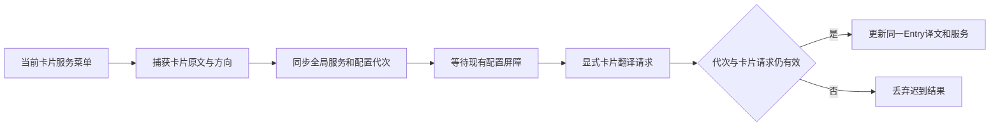

# 悬浮窗服务显示与切换

| 元信息 | 内容 |
| --- | --- |
| 状态 / 更新 | 草稿 / 2026-10-09 |
| 分级 / 生命周期 | 标准档，spec-anchored，供实现、审查与后续维护 |
| 讨论入口 | 用户确认 A：全局切换，并立即重新翻译当前卡片 |
| 关联来源 | [既有跟随与服务设计](caret-translation.md)，承接配置代次、原文保护及浮窗生命周期 |
| 条件节 | 跨 App/Overlay 接口、并发状态、安全边界及增量回滚；无持久化数据迁移 |

> 读者先看背景、做法和边界；接口与验收是实现者契约。本文件同时作为工作流 overlay-service 的长期设计记录。

## 一句话方案

翻译卡保存原文、语言方向及生成该译文的服务；头部提供服务下拉，选择后同步全局设置，通过配置屏障重新翻译所选卡片原文，并仅更新仍存活的该卡片。

## 背景与目标

截图中的悬浮窗只有「润物」标题，用户无法识别服务或就地切换。App 已有五类服务与配置代次，但 Overlay Entry 只有文本，剪贴板卡也未保存原文；applyTranslationSettings 会清理未钉住的卡片。此增量需要保留显式切换的目标，而不是重新读取当前输入框。

目标对应用户两项需求：每张翻译卡显示结果归属服务；点击下拉立即重译这张卡的原文并影响后续全局请求。用户第三项仅询问原因，SentenceExtractor 的当前句及分号规则不变。

## 做法

### 1. 结果与全局配置分别归属

| 对象 | 权威来源 | 规则 |
| --- | --- | --- |
| 译文服务标签 | 接受结果时捕获的 backend | 不随全局配置变化把旧译文改标为新服务 |
| 原文及语言方向 | 该次已接受请求 | 实时、剪贴板卡均保存，显式重译不再次读取 AX 或剪贴板 |
| 下拉选项与全局默认 | 既有 TranslationBackend / SettingsStore | 五类服务全量复用，选择写入既有持久化设置 |
| 目标卡生命周期 | Overlay Entry UUID | 关闭、移除后迟到结果不能重建卡片；保留钉住、拖动位置和当前锚点 |

### 2. 显式重译链路

这条请求由已显示的卡片授权，输入焦点变化不应改换其原文；新输入可以继续走实时链路，不能因重译接管输入替换。

### 3. 状态与交互

| 事件 | 行为 |
| --- | --- |
| 选择不同服务 | 同步设置、取消旧配置请求，保留目标卡、发起一次新请求；菜单勾选全局服务 |
| 同服务且无在途重译 | 不重复请求；旧卡服务不同于当前全局时可显式重译到所选服务 |
| 请求中 | 卡片保留，明确显示目标服务正在翻译；保留旧译文则仍标旧服务，不能混淆归属 |
| 成功 | 同一 UUID 更新原文对应译文及服务，保留 pin/拖动状态；仅合法结果可记录历史 |
| 失败 | 使用既有受控错误提示，保留原译文及其归属；不把错误当译文或复制/替换内容 |
| 再切换、关闭、暂停或配置变化 | 取消/淘汰旧请求；迟到回复不能覆盖新服务或重新出现已关闭卡 |
| 菜单展开或重译中 | 暂停目标卡自动隐藏，结束后恢复既有策略；其他钉住卡不被重译或改标签 |

UI 可采用系统下拉控件或 SwiftUI Menu，但必须穿透全卡透明拖拽层，并在非激活面板上可操作。实际菜单事件、hitTest 与非激活状态需独立证据；不能只测试回调函数。

## 备选与取舍

| 做法 | 取舍 |
| --- | --- |
| 只显示当前全局服务 | 旧卡/钉住结果会被错标，故保存每次结果服务 |
| 切换后重新采样输入/剪贴板 | 会读到另一句或新剪贴板，故使用所选卡原文 |
| 仅修改设置等待下一次输入 | 不满足已确认的立即重译，故提供显式请求入口 |
| 改造历史数据库保存服务 | 此需求仅涉及存活浮窗，新增迁移无必要，故仅保存内存卡片上下文 |

## 接口与数据形状

预期形状如下；实际符号名称在交付时按源码回写。

| 接口 | 契约 |
| --- | --- |
| Overlay 卡片翻译上下文 | 原文、source/target Language、结果 backend；仅内存，不含密钥/模型配置 |
| 接受正常结果 | App 捕获请求 backend，与原文及语言方向一起传入实时/剪贴板卡 |
| 服务选择回调 | Entry UUID + TranslationBackend；校验存活且有原文，再进入 App 全局设置路径 |
| 显式苹果方向宿主 | 当前全局方向相同可复用既有服务；不同方向建立临时 holder/host，以卡片方向创建 HostedTranslationEngine，不改变全局语言配置，完成或失效释放 |
| 显式卡片请求身份 | Entry UUID、独立请求序号/UUID、configurationGeneration；使用配置屏障和不可变服务快照 |
| Overlay 更新接口 | 按 UUID 更新现有卡，不使用 show 新建代替；保留其 pin/位置/anchor，支持 loading 与恢复自动隐藏 |
| 预览卡 | 无真实原文/译文归属，显示预览标识，不伪造苹果服务或发起重译 |

## 明确不做

不改当前句提取、输入法组合检测或服务协议，不引入模型级下拉或历史库迁移；不改变自动复制/替换授权，服务切换只显式重译，不自动写回输入框或剪贴板。不访问真实密钥/私有文本，不安装重启用户应用，不推送或改已发布 v0.1.0/DMG。

## 已知限制

| 风险/限制 | 触发与处理 |
| --- | --- |
| 原生菜单被拖拽层吞点击 | 必须以真实控件 hitTest/菜单事件核验头部命中，正文仍可拖动 |
| 旧请求/缓存错服务 | 配置屏障、卡片请求身份与关闭状态联合验收；覆盖非合作取消的迟到回复 |
| 服务不可用或无启用模型 | 既有受控错误；保留旧结果与正确标签，全局服务仍按用户选择持久化 |
| 旧钉住卡与苹果宿主方向不同 | 卡片保持生成时语言方向。显式苹果请求需要独立的按卡片方向配置的临时 holder/原生 host；与实时全局 host 隔离，请求结束或失效释放。语言包未准备时沿用受控失败，保留旧结果；不修改全局语言方向 |
| 真实宿主菜单与 focus | 隔离非激活窗口测试可覆盖 native 交互结构；真实应用焦点表现仍需使用反馈 |
| 模型路由内部回退 | 只标既有「大语言模型 API」服务类别，不承诺展示实际模型名称 |

安全约束：MUST 不重新读取 AX/剪贴板、不读取真实密钥、不自动复制/替换、不把服务错误写作译文、不新增原文或密钥日志。诊断沿用受控类别和状态；不新增遥测。

### 4. 兼容与回滚

既有 backend 持久化键、历史库及 SentenceExtractor 均兼容。预览无原文时不重译；正常卡片都由请求补齐上下文。若真实菜单无法操作或切换出现错服务，回退此工作流提交并重建本地应用；无需迁移用户数据，耗时取决于本机 Swift 构建，不作固定时限承诺。

## 验收标准

| 不变量 | 保证方式 | 证据 |
| --- | --- | --- |
| 当前译文标签正确且老钉住卡不误标 | 每结果捕获 backend | 五服务路由/切换前后卡片元数据与 native header 渲染 |
| 全局持久化与立即重译原文 | 卡片上下文 + 配置屏障 | 实时/剪贴板/钉住卡切换，UserDefaults 与 mock engine 收到精确原文 |
| 快速切换/关闭不会被旧结果覆盖 | 配置代次 + 卡片请求身份 | A→B→C/A、late completion、关闭/暂停/普通设置变更及新输入竞态 |
| 下拉可点击，正文拖动/按钮/滚动不回归 | 精确 hitTest 和 native 控件链路 | 隔离原生菜单事件、NSPanel 非激活检查、窄卡头部截图 |
| 旧安全与跟随行为继续有效 | 沿用既有生命周期和协议 | 全量 swift test、release 构建和 strict 签名 |

## 决策摘要

| ID | 决策 | 来源 | 理由 |
| --- | --- | --- | --- |
| D-01 | 标出生成当前译文的服务并提供头部下拉 | 用户 | 当前明确功能需求与已呈现的润物·服务方案 |
| D-02 | 全局切换并立即重译所选卡片原文 | 用户 | 用户明确选择 A，后续请求同步新服务 |
| D-03 | 分句规则不改，保持润物身份及现有服务 | 用户 | 第三项只解释原因，功能增量以现有品牌和服务为基础 |
| D-04 | 内存卡片上下文、独立显式请求身份、受控失败与 native 交互验收 | agent | 支撑 A 同时避免重新读文本、迟到覆盖、错标签和拖拽层吞点击；无数据库迁移 |

## 实际交付

无（尚未实现；交付时回写实际符号、产物及验证边界）。
