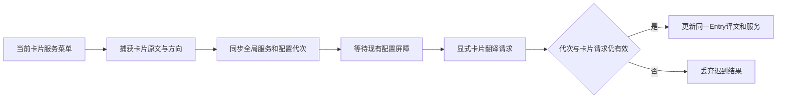

# 悬浮窗服务显示、切换与输入资格

| 元信息 | 内容 |
| --- | --- |
| 状态 / 更新 | 实现 / 2026-10-09 |
| 分级 / 生命周期 | 标准档，spec-anchored，供实现、审查与后续维护 |
| 讨论入口 | 用户确认 A：全局切换并立即重译当前卡片；追加修复非输入状态误翻译 |
| 关联来源 | [既有跟随与服务设计](caret-translation.md)，承接配置代次、原文保护及浮窗生命周期 |
| 条件节 | 跨 App/Overlay 接口、并发状态、安全边界及增量回滚；无持久化数据迁移 |

> 读者先看背景、做法和边界；接口与验收是实现者契约。本文件同时作为工作流 overlay-service 的长期设计记录。

## 一句话方案

翻译卡保存原文、方向和结果服务；下拉同步全局并通过配置屏障重译原文，只更新存活卡。同步修复非输入误翻译：自动输入链路在读取内容前核实真正焦点及编辑资格。

## 背景与目标

截图中的悬浮窗只有「润物」标题，用户无法识别服务或就地切换。App 已有五类服务与配置代次，但 Overlay Entry 只有文本，剪贴板卡也未保存原文；applyTranslationSettings 会清理未钉住的卡片。此增量需要保留显式切换的目标，而不是重新读取当前输入框。

目标对应用户两项需求：每张翻译卡显示结果归属服务；点击下拉立即重译这张卡的原文并影响后续全局请求。用户第三项仅询问原因，SentenceExtractor 的当前句及分号规则不变。随后用户明确要求同步处理 Finder 浏览目录时翻译文件夹名。源码确有按 role 放行只读字段、下探任意首个文本后代的可达路径；未读取用户实际 Finder AX 树，具体树形为推断，先用合成 Finder 列表复现该路径。此增量排除非编辑控件，不新增“必须键入”规则或输入监控权限。

## 做法

### 1. 结果与全局配置分别归属

| 对象 | 权威来源 | 规则 |
| --- | --- | --- |
| 译文服务标签 | 接受结果时捕获的 backend | 不随全局配置变化把旧译文改标为新服务 |
| 原文及语言方向 | 该次已接受请求 | 实时、剪贴板卡均保存，显式重译不再次读取 AX 或剪贴板 |
| 下拉选项与全局默认 | 既有 TranslationBackend / SettingsStore | 五类服务全量复用，选择写入既有持久化设置 |
| 目标卡生命周期 | Overlay Entry UUID | 关闭、移除后迟到结果不能重建卡片；保留钉住、拖动位置和当前锚点 |

### 2. 显式重译链路

这条请求由已显示的卡片授权，输入焦点变化不应改换其原文；新输入可以继续走实时链路，不能因重译接管输入替换。

### 3. 状态与交互

| 事件 | 行为 |
| --- | --- |
| 选择不同服务 | 同步设置、取消旧配置请求，保留目标卡、发起一次新请求；菜单勾选全局服务 |
| 同服务且无在途重译 | 不重复请求；旧卡服务不同于当前全局时可显式重译到所选服务 |
| 请求中 | 卡片保留，明确显示目标服务正在翻译；保留旧译文则仍标旧服务，不能混淆归属 |
| 成功 | 同一 UUID 更新原文对应译文及服务，保留 pin/拖动状态；仅合法结果可记录历史 |
| 失败 | 使用既有受控错误提示，保留原译文及其归属；不把错误当译文或复制/替换内容 |
| 再切换、关闭、暂停或配置变化 | 取消/淘汰旧请求；迟到回复不能覆盖新服务或重新出现已关闭卡 |
| 菜单展开或重译中 | 暂停目标卡自动隐藏，结束后恢复既有策略；其他钉住卡不被重译或改标签 |

UI 可采用系统下拉控件或 SwiftUI Menu，但必须穿透全卡透明拖拽层，并在非激活面板上可操作。实际菜单事件、hitTest 与非激活状态需独立证据；不能只测试回调函数。

### 4. 输入资格先于内容读取

| 判定 | 规则 |
| --- | --- |
| 原焦点元素 | `AXFocusedUIElement` 为权威原焦点；不强制额外 AXFocused=true，但明确 false 不接受 |
| 容器后代 | 只能接纳显式 AXFocused=true 的编辑候选，不以行选中、首个文本 role 或唯一后代推断焦点；安全的中间容器 AXFocused=false 只表示它不是候选，仍可向下找真正聚焦字段，readonly/disabled/安全拒绝与查询错误仍剪枝 |
| 明确不可编辑/禁用 | AXEditable=false 或 enabled=false 否决，即使 role 为 TextField/TextArea/ComboBox |
| 明确可编辑 | AXEditable=true 可以支持无法直接写整段 AXValue 的网页/IDE编辑器；安全检查仍必须通过 |
| 原生缺可选编辑标记 | AXEditable unsupported/noValue时，原有 TextField/TextArea/ComboBox role保留兼容，但不能覆盖明确false；不新增未知资格全局拒绝或AXValue setter硬门 |
| 元数据错误或预算耗尽 | 非可选错误、非法值或budget exhausted不回退按role放行；沿用安全fail-closed，不增加权限 |
| 资格失效 | 原焦点或同handle资格变明确只读/失焦/元数据错误时清session和快捷恢复缓存、淘汰旧debounce/current请求；恢复后同文本使用新会话 |

capture、快捷恢复和replace读前/写前共用资格检查，资格失效不得恢复旧缓存或先读正文再决定。安全/pid/密码/排除与总读取预算先行；资格和几何分别处理，无有效caret仍可在有编辑证据时按既有输入框位置降级。Finder搜索及重命名属于真实输入时继续可用，不全bundle排除Finder。组合状态未知仍按既有保护处理。

## 备选与取舍

| 做法 | 取舍 |
| --- | --- |
| 只显示当前全局服务 | 旧卡/钉住结果会被错标，故保存每次结果服务 |
| 切换后重新采样输入/剪贴板 | 会读到另一句或新剪贴板，故使用所选卡原文 |
| 仅修改设置等待下一次输入 | 不满足已确认的立即重译，故提供显式请求入口 |
| 改造历史数据库保存服务 | 此需求仅涉及存活浮窗，新增迁移无必要，故仅保存内存卡片上下文 |
| 全部排除Finder | 会误伤搜索/重命名等真实输入，故按元素焦点及编辑资格判断 |
| 只按role或selection跳过明确编辑元数据 | role与selection可能只读；先处理明确编辑/禁用证据，缺可选标记仅保留原role兼容，错误不当缺失 |

## 接口与数据形状

实际接口保持现有翻译协议及设置键；新增状态仅在内存中。

| 接口 | 契约 |
| --- | --- |
| `OverlayTranslationContext` | `sourceText`、`sourceLanguage`、`targetLanguage`、`backend`，由接受结果的请求快照构造；剪贴板原文保存在上下文中，延续原卡只显示译文的正文布局 |
| `AppState.acceptTranslationResult` | 实时/剪贴板通过原有请求与配置校验后附带上下文，服务不会从返回时全局设置重新读取 |
| `OverlayCoordinator.onServiceSelected` → `AppState.selectOverlayService(_:backend:)` | UUID + backend；校验启用且卡片有上下文，持久化全局 backend，目标 UUID 通过 `preservedServiceCard` 穿过设置和输入 reset 清理，再等待 `configurationReady` |
| `AppState.CardRequest` / `cardRequests` | 卡片 UUID 索引，保存独立请求 UUID、配置代次、Task、独立 coordinator、可选 holder/host；每次创建 `TranslationService` 捕获所选服务、模型链、timeout 与初始化注入的 engines/modelFactory，不复用其他卡缓存 |
| `acceptsCardRequest` / `cancelCardRequest` | 配置代次、请求 UUID、存活卡和 enabled 联合校验；取消外层 Task 及 coordinator 的底层 engine task，关闭临时 host；迟到回复不得重建卡 |
| `beginRetranslation` / `finishRetranslation` | 原 UUID 更新 loading、受控失败或合法结果；旧译文仍标旧服务；成功更新上下文并记录历史，不走 pending copy/replace/speech 路径 |
| `OverlayServicePopUpButton` / `OverlayServiceNativeMenu` | 真正原生下拉；不成为 first responder、不要求 panel 成为 key；拖拽层按真实 control bounds 穿透。菜单保留 delegate，保证 action 重建 hosting view 后 `menuDidClose` 仍平衡计时 |
| `setMenuOpen` / `pendingBackend` | 展开及重译暂停自动隐藏，结束恢复原策略；全局勾选刷新 rootView，不重测其他卡的用户缩放视口；更新目标结果时重新测量并保留 detached 卡 top-left |
| 不同方向苹果 host | 卡片方向异于全局时创建临时 `TranslationSessionHolder` + `TranslationHostWindowController`；使用原 `TranslationHostView`，完成/取消 `close()` 清 contentView 与窗口；不修改全局方向及 holder |
| `OverlayCoordinator.Entry.chromeHeight` | `installContent` 缓存该卡含状态行的实际 chrome 测量；`recordResize` 和 `settleResize` 直接复用相同值，拖动事件不新建测量窗口 |
| 预览卡 | 无真实上下文，显示预览标题，不提供服务重译菜单，不伪造服务 |
| `AXFieldReader.eligible` / `resolve` | 安全和 pid 先行，再核焦点、enabled 与 AXEditable；原焦点允许缺可选 AXFocused，搜索后代必须显式 true。明确 false、非法值、非可选错误与预算耗尽拒绝，编辑标记可选缺失保留既有标准文本 role |
| `AccessibilityMonitor.focusedRequiresExplicitFocus` / `permitsContent` | 保留解析候选的焦点来源要求，capture、快捷恢复及 replace 内容读前/写前复验；权威原焦点在同应用内再次核 app 的 AXFocusedUIElement，后代保留显式焦点证明，内容返回后也验证会话仍有效；失效走 `setFocused(nil)` 清会话和恢复缓存，通知 App 淘汰旧输入请求 |
| `AXFieldAccess.writeAttribute` | 默认沿用系统 AX setter 与 50ms 消息 timeout；bounded 包装在本次 120ms 预算耗尽时返回 cannotComplete、不发写操作。测试注入计数闭包验证写前竞态，不查询 AXValue 可写能力作为输入资格 |

## 明确不做

不改当前句提取、输入法组合检测或服务协议，不新增keyboard event tap或权限、不把非输入问题扩大为仅键入触发规则，不引入模型级下拉或历史库迁移；不改变自动复制/替换授权，服务切换只显式重译，不自动写回输入框或剪贴板。不访问真实密钥/私有文本，不安装重启用户应用，不推送或改已发布 v0.1.0/DMG。

## 已知限制

| 风险/限制 | 触发与处理 |
| --- | --- |
| 缺编辑元数据的宿主 | 保留原焦点标准文本role兼容，无法仅靠role识别所有未标明只读的控件。当前修复已明确的readonly/disabled及无焦点后代路径；缺元数据宿主后续按实际反馈适配，可用剪贴板。容器后代缺明确焦点证明不采纳 |
| Finder复现范围 | 合成AX handles与注入元数据复现可达误判，尚未从用户Finder读取真实树或实机点击核验，不能宣称该层已验证 |
| 状态卡缩放预算 | 手动 resize 必须复用内容安装时含状态行的 chrome 测量，loading/失败与无状态均保持窗口和正文预算一致；不得退回无状态常量 |
| 原生菜单被拖拽层吞点击 | 必须以真实控件 hitTest/菜单事件核验头部命中，正文仍可拖动 |
| 旧请求/缓存错服务 | 配置屏障、卡片请求身份与关闭状态联合验收；覆盖非合作取消的迟到回复 |
| 服务不可用或无启用模型 | 既有受控错误；保留旧结果与正确标签，全局服务仍按用户选择持久化 |
| 旧钉住卡与苹果宿主方向不同 | 卡片保持生成时语言方向。显式苹果请求需要独立的按卡片方向配置的临时 holder/原生 host；与实时全局 host 隔离，请求结束或失效释放。语言包未准备时沿用受控失败，保留旧结果；不修改全局语言方向 |
| 新输入与历史卡请求 | 新输入替换/移除活动实时卡时，其请求失效；仍存活的钉住卡和独立剪贴板卡按已显示原文继续重译，只更新自己的 UUID。焦点变化不改换原文；关闭/配置变化/暂停仍会取消 |
| 原生菜单与 focus | 隔离测试已实际 performClick 打开系统菜单、执行 NSMenuItem action 并收到关闭回调，核验非激活标志；跨真实应用的焦点表现仍需使用反馈 |
| 苹果语言包及真实 session | 不下载包、不伪造 TranslationSession。隔离测试使用真实 holder 配置和 generation host 的无 translationTask 子视图，核卡片方向与清理；实际语言包准备、native attach 和翻译需实际使用验证 |
| 模型路由内部回退 | 只标既有「大语言模型 API」服务类别，不承诺展示实际模型名称 |

安全约束：显式卡片重译 MUST 使用保存的原文，不重新读取 AX/剪贴板；输入采样 MUST 在资格校验后读取内容。不读取真实密钥、不自动复制/替换、不把服务错误写作译文、不新增原文或密钥日志。诊断沿用受控类别和状态；不新增遥测。

### 4. 兼容与回滚

既有 backend 持久化键、历史库及 SentenceExtractor 均兼容。预览无原文时不重译；正常卡片都由请求补齐上下文。若真实菜单无法操作或切换出现错服务，回退此工作流提交并重建本地应用；无需迁移用户数据，耗时取决于本机 Swift 构建，不作固定时限承诺。

## 验收标准

| 不变量 | 保证方式 | 证据 |
| --- | --- | --- |
| 当前译文标签正确且老钉住卡不误标 | 每结果捕获 backend | 五服务路由/切换前后卡片元数据与 native header 渲染 |
| 全局持久化与立即重译原文 | 卡片上下文 + 配置屏障 | 实时/剪贴板/钉住卡切换，UserDefaults 与 mock engine 收到精确原文 |
| 快速切换/关闭不会被旧结果覆盖 | 配置代次 + 卡片请求身份 | A→B→C/A、late completion、关闭/暂停/普通设置变更及新输入竞态 |
| 下拉可点击，正文拖动/按钮/滚动不回归 | 精确 hitTest 和 native 控件链路 | 隔离原生菜单事件、NSPanel 非激活检查、窄卡头部截图 |
| 非编辑控件不能产生输入翻译 | 焦点来源与编辑元数据分开校验，内容读前复验 | Finder列表/三role readonly实际red→green、内容与服务计数0、native/web正例、能力失效与晚回复、secure/IME/budget回归 |
| 状态卡缩放预算一致 | 每entry实际chrome复用 | loading/失败长卡native手动缩放、top-left/正文预算一致 |
| 旧安全与跟随行为继续有效 | 沿用既有生命周期和协议 | 全量 swift test、release 构建和 strict 签名 |

## 决策摘要

| ID | 决策 | 来源 | 理由 |
| --- | --- | --- | --- |
| D-01 | 标出生成当前译文的服务并提供头部下拉 | 用户 | 当前明确功能需求与已呈现的润物·服务方案 |
| D-02 | 全局切换并立即重译所选卡片原文 | 用户 | 用户明确选择 A，后续请求同步新服务 |
| D-03 | 分句规则不改，保持润物身份及现有服务 | 用户 | 第三项只解释原因，功能增量以现有品牌和服务为基础 |
| D-04 | 内存卡片上下文、独立显式请求身份、受控失败与 native 交互验收 | agent | 支撑 A 同时避免重新读文本、迟到覆盖、错标签和拖拽层吞点击；无数据库迁移 |
| D-05 | 每个显式请求持有独立服务/coordinator 配置快照 | agent | 捕获完整模型回退链并隔离实时缓存；代价是显式请求不复用其他卡的缓存 |
| D-06 | 不同方向苹果会话采用请求级临时 holder/host | agent | 保持卡片原方向与全局方向独立；取消/完成关闭视图；语言包与真实 session 仍需运行时准备 |
| D-07 | 原生 NSPopUpButton、真实 bounds 穿透、菜单强持有 delegate | agent | 非激活面板可操作，hosting view 刷新后关闭事件仍能恢复计时；视觉使用系统菜单 |
| D-08 | 全局勾选刷新与目标结果重测分别处理 | agent | 保留其他卡缩放视口，目标长译文可变尺寸但保持 top-left/身份，不重新 show |
| D-09 | 新输入失效按卡片生命周期判定 | agent | 活动卡被替代/移除则取消；仍存活的历史 pin/clip 继续其显式授权，符合独立卡原文设计。将计划“新输入淘汰旧请求”的宽泛措辞澄清到具体活动卡，无当前输入写回授权 |

| D-10 | 排除非编辑控件误翻译，保留真实输入及原有光标选句 | 用户 | 用户明确要求同步处理Finder截图；既有光标选句已接受，没有要求新增仅键入限制 |
| D-11 | 后代焦点须证明；明确readonly/disabled否决且元数据预算/错误保真 | agent | 修复role短路与DFS首个后代。独立审查后不新增unknown全局拒绝/AXValue setter硬门，保持原焦点标准role兼容；缺元数据只读宿主仍需实际反馈适配 |
| D-12 | 状态卡缩放复用每entry实际chrome | agent | 终审Minor发现resize用旧无状态预算，须与含loading/失败行的内容测量一致 |
| D-13 | AX 写操作纳入现有访问注入和样本预算 | agent | 复用原系统 setter，便于隔离核验 replace 读后资格变化/写前预算失效而不写用户内容；无新的可写能力硬门。写资格复验增加元数据调用，耗尽预算则本次失败，后续可信采样恢复 |
| D-14 | 中间容器焦点与最终编辑候选分开处理 | agent | 独立源码 harness 证明 AXFocused=false 的安全包装层会误剪掉 focused=true 的子编辑框；原权威焦点显式 false 仍拒绝，后代编辑候选仍须 true，安全/只读/禁用/错误剪枝不放宽 |

## 实际交付

| 交付物 | 内容及验证 |
| --- | --- |
| `Sources/Pico/App.swift`、`Overlay.swift`、`L10n.swift` | 两种输入来源保存服务归属；原生菜单同步全局并重译所选卡；独立请求、受控失败、计时/关闭与临时方向宿主 |
| `Tests/PicoTests/OverlayServiceMetadataTests.swift` | 6 项新测试：五服务双 origin、原文方向、pin/refresh/preview、迟到结果及中英原生头部渲染 |
| `Tests/PicoTests/OverlayServiceSwitchingTests.swift` | 11 项新测试：五路选择、精确 source、并发失效/非合作取消、资源释放、真正菜单 tracking/action/关闭与 hitTest、窄卡/六主题/长 pin 布局；loading/失败/无状态的真实 NSHostingView/NSPanel 缩放接线回归 |
| `Sources/Pico/CaretTracking.swift`、`Input.swift` | 原焦点/后代焦点来源、编辑资格及内容读写前复验；资格失效清会话与恢复缓存，写访问注入沿用预算和系统 setter |
| `Tests/PicoTests/FocusedEditableInputTests.swift`、`CaretTrackingTests.swift` | 新增 14 项输入资格用例，合成 Finder 列表、三类只读 role、明确聚焦后代、原生缺可选元数据兼容、网页编辑、错误/预算/资格变化、真实 App 迟到回复与替换假写。原 25 项安全/几何/IME 回归保留；3 项 baseline 用例先产生 17 个断言失败，修复后通过；独立审查发现安全未聚焦包装层误剪枝，新增用例先失败、修复后通过并保留否决负例 |
| `README.md`、本设计 | 操作范围、旧卡标签、失败、预览与分句说明；实际接口和执行期技术裁定归位 |
| 本地 `润物.app` | 本轮源码构建，继续使用 `com.comeg.runwu` / 0.1.0；验收命令 `swift test && zsh Scripts/build-app.sh && codesign --verify --deep --strict 润物.app` |

服务相关 83 项、输入修复最终相关 93 项，以及状态缩放相关 49 项阶段测试通过；原生卡片/真实菜单截图保存在 `.workflow/overlay-service/reports/T2-native/`，状态缩放截图在同级 `T5-native/`，已核状态行、三按钮与拖动柄；证据目录不进 Git，测试可重新生成。缩放回归经安装视图的 resize 回调驱动原生窗口，未声称物理鼠标拖动已实测。完整测试、release 构建及严格签名由最终工作流验证记录承载。

D-09 澄清新输入与仍存活历史卡边界；D-10 承接用户追加的非输入误翻译修复，D-11 保留可选缺失原生 role 兼容，D-13 用注入验证资格失效时不写用户内容，D-14 闭合独立审查发现的中间包装层误剪枝；D-12 修复 loading/失败缩放少计 20pt 的 chrome 预算，先红后绿。无分句、服务协议、历史库迁移或远端发布偏离。主图标、菜单栏图标和已发布 DMG 保留；真实宿主焦点、语言包和真实服务网络未实测，见已知限制。
